# CausalBridge v2.0

**An ATAC-bridged framework for single-cell perturbation prediction.** CausalBridge uses WT scRNA-seq + scATAC-seq to connect TF→peak→gene through chromatin accessibility and predict RNA and ATAC changes after gene or peak interventions along pseudotime, without perturbation training data. The Python package version is `2.0.0`.

This guide covers the model, input preparation, execution, interpretation, and configuration. See [config.yaml](config.yaml) for the complete configuration. Outputs are conditional predictions: motifs, pseudotime lags, and Granger screening provide directional evidence but cannot independently establish intervention causality. See [FIGUERS_README.md](FIGUERS_README.md) for figure fields and interpretation.

Contents:

1. [Principles and model architecture](#principles)
2. [Installation and quick start](#installation)
3. [Data, gene identity, and reference views](#data)
4. [Pseudotime and binning](#pseudotime)
5. [Inferring the two regulatory layers](#edges)
6. [Response functions and supported groups](#responses)
7. [Perturbation engine and examples](#perturbation)
8. [Units, cell endpoints, and cross-cluster aggregation](#endpoints)
9. [Outputs, caching, and recovery](#outputs)
10. [Visualization and pathways](#visualization)
11. [Configuration reference](#configuration)
12. [Limitations and interpretation](#validation)
13. [Modules and method sources](#modules)
14. [Release history](#changelog)

<a id="principles"></a>
## 1. Principles and model architecture

### Why bridge through ATAC?

RNA coexpression describes covariation between cell states, but does not directly distinguish regulation, mediation, and shared upstream factors. CausalBridge inserts a peak layer between TF RNA and target-gene RNA: motifs provide candidate binding evidence, peak–gene distance limits the candidate set, and pseudotime lag tests and nonlinear responses describe predictive relationships between states.

Chromatin remodeling and subsequent transcription can differ in state, a phenomenon termed **cell-state parallax**. Accessibility may precede expression in some processes, but one cannot assume that every cell's ATAC represents the same earlier real time. Pseudotime is inferred from cross-sectional data; lag is measured in bins, not hours. RNA expression is also a proxy for TF activity, rather than a direct measurement of protein abundance or binding activity.

```text
Gene intervention → TF RNA change → peak accessibility change → target-gene RNA change
                          ↑                                            │
                          └──── continue if a downstream gene is a TF ──┘
```

The model learns bounded WT mappings from TF RNA→peak accessibility and peak accessibility→target-gene RNA, then predicts changes from differences between mapping values before and after perturbation. These mappings describe statistical relationships in WT states; WT observations cannot uniquely identify the true intervention response.

### Two layers and their treatment of time

| Layer / stage | Method | Time handling | Role of output |
|---|---|---|---|
| TF→peak candidates | Motifs, factor mappings, target-TF family evidence | Does not define time | Restrict regulatory inputs |
| peak→gene screening | Distance candidates + Granger F test | One-step lag in the standard route | Predictive improvement and screening scores |
| Responses in both layers | Each hybrid layer independently selects a bounded function | WT rows aligned for that layer | Nonlinear state responses |
| Perturbation | bin_forward | Advances by edge lag and the next gene bin | Conditional predictions and event evidence |

The multiple-lag TF→peak search and one-step peak→gene test serve different purposes. Selecting the first significant lag does not guarantee a true or globally optimal delay. Gaussian smoothing, coexpression, confounding, and feedback can all affect inferred direction.

### Current configuration and modes

| Setting | Explicit repository configuration | Meaning |
|---|---|---|
| `input.gene_identity_mode` | gtf_gene_id | GTF stable-ID model axis; legacy if omitted |
| `atac_to_rna.model_mode` | saturating_hybrid | The only supported mode; singles / supported input groups |
| `atac_to_rna.response_model` | nn | Independent CPU NN for peak→gene |
| `rna_to_atac.response_model` | spline | Bounded spline for TF→peak |
| `preprocess.atac_depth_normalization.enabled` | true | Continuous model view; library default is off |
| `pseudotime.smooth_kernel` | gaussian | Fixed Gaussian soft binning |
| `pseudotime.adaptive_binning.enabled` | false | Shared adaptive plan is optional |
| `pseudotime.root_cell_method` | cytotrace | Official root selection for each actual modeling cohort |
| `perturbation.joint_knockout` | true | Jointly intervene on genes in the target file |
| `perturbation.aggregation_policy` | valid_cell_means | Merge means over the same valid cell subset |

These are current file settings, not all API defaults. Both response families default to saturation when omitted; aggregation defaults to strict_complete, and the saturation budget-exhaustion policy defaults to exclude. The current file explicitly selects best_finite. Configuration changes affect the next run and do not rewrite historical CSV files.

<a id="installation"></a>
## 2. Installation and quick start

Run from the repository root. Install Python and R dependencies separately, keeping R, its packages, and native libraries in the same `CausalBridge` conda environment.

```bash
conda create -n CausalBridge -c conda-forge python=3.11
conda activate CausalBridge
pip install -r requirements.txt
pip install scikit-misc
conda install -n CausalBridge -c conda-forge 'r-base>=4.0' r-matrix r-hiclimr r-ccapp r-nnls r-rcpp r-ncdf4

git clone https://github.com/gunsagargulati/CytoTRACE.git ../CytoTRACE_official
git -C ../CytoTRACE_official checkout f4ff6c0ab93cc704eef44e17adcd5c6baf09703a
```

`scikit-misc` is an additional dependency for the current `seurat_v3` HVG selection. The runner directly sources the verified official `R/CytoTRACE.R`; its core R dependencies are Matrix, HiClimR, ccaPP, and nnls. Conda also resolves transitive dependencies such as pcaPP, robustbase, and netCDF. **Installing an R package with the same name does not replace the official source directory above.** To also install the complete CytoTRACE R package, first install every `Imports` dependency from the pinned source's `DESCRIPTION` (including Bioconductor `sva`), then run:

```bash
R CMD INSTALL -l "$CONDA_PREFIX/lib/R/library" ../CytoTRACE_official
```

Installing the complete package and running the source directly have different dependency requirements; `pip install` installs no R packages. R plotting additionally needs ggplot2, dplyr, tidyr, ggrepel, patchwork, igraph, and jsonlite to read joint-target JSON, for example:

```bash
conda install -n CausalBridge -c conda-forge r-ggplot2 r-dplyr r-tidyr r-ggrepel r-patchwork r-igraph r-jsonlite
```

Prepare raw-count RNA / ATAC AnnData and a GTF / FASTA. Cell barcodes must match uniquely; ATAC `.var` must provide `chr`, `start`, and `end`. In GTF mode, RNA must provide the configured stable-ID column. Copy the configuration and replace machine-specific paths, the target file, and output directories; do not retain the repository's personal absolute paths. The target file contains one gene token per line. Explicit stable IDs are recommended in GTF mode; unique symbols and resolved numbered aliases are also accepted.

```bash
cp config.yaml config.local.yaml
# Edit config.local.yaml to set your own input, target, and output paths
python run_example.py config.local.yaml --dry-run
python run_example.py config.local.yaml
# Optional: more logging
python run_example.py config.local.yaml --verbose
```

The main entry point takes configuration as a **positional argument**, without `--config`. `--dry-run` only loads configuration and data; it does not perform full fitting or validate the R runtime and every downstream stage end to end.

Minimal path example (merge into the full configuration; do not use this fragment alone):

```yaml
input:
  gene_identity_mode: gtf_gene_id
  annotation_gtf: /path/to/genes.gtf.gz
  rna_gene_id_column: gene_ids
  rna_h5ad: /path/to/rna_adata.h5ad
  atac_h5ad: /path/to/atac_adata.h5ad
  genome_fasta: /path/to/genome.fa
  target_genes: /path/to/my_targets.txt
cytotrace:
  official_source_dir: ../CytoTRACE_official
  seed: 42
output:
  dir: results/my_run
  cache_dir: cache/my_run
  checkpoint_dir: null
  save_intermediate: true
```

Remove copied `cytotrace.rscript_binary`, `r_library_dir`, and `native_library_dir` settings that do not belong to your environment to use paths inferred from the active conda Python environment. Alternatively, provide real absolute paths within that same environment. Do not write YAML paths as `$CONDA_PREFIX/...`: the loader does not guarantee shell environment-variable expansion. Relative CytoTRACE paths resolve from the repository root.

The official version is CytoTRACE 2020 / 0.3.1, pinned to commit `f4ff6c0...` above. The SHA256 of `R/CytoTRACE.R` must be `7dafcfa42c792eaffe1048f4716cb54105b31f2ad01c4f0c26868c10593b155d`. The runtime isolates R package and native libraries, clears inherited R settings, and retains underlying loading errors for diagnosis. Failed official computation is not replaced with heuristic scores.

The Python entry point remains available:

```python
from CausalBridge import __version__
from CausalBridge.run import run_pipeline

print(__version__)  # 2.0.0
results = run_pipeline("config.local.yaml")
```

<a id="data"></a>
## 3. Data, gene identity, and reference views

`gtf_gene_id` first audits every input gene, matching `rna_gene_id_column` to GTF gene records and stripping only a trailing numeric ID version. Duplicate IDs after normalization raise an error; counts are not merged automatically. Unmatched features are removed from model eligibility without modifying the original H5AD. Model normalization denominators and raw-count HVG ranking use all GTF-eligible genes before HVG / required-target retention. Retaining extra targets or root markers does not set their `highly_variable` flag to true or bypass expression QC.

Internal calculations, edge keys, cross-cluster merging, and projection feature axes use stable IDs. `gene_name` is the biological symbol; `gene_display_name` is the display label. Different IDs with the same name receive fixed aliases such as `A_01`, `A_02`, ordered by stable ID in the full reference; HVG selection or subsetting does not renumber them. Motif matching still uses native symbols and expands to allowed IDs. Targets and explicit root markers accept stable IDs, versioned IDs, unique symbols, or numbered aliases. Ambiguous symbols must be resolved explicitly; failed required genes or genes removed by QC raise clear errors.

The complete GTF gene span is authoritative. Coordinates convert from 1-based closed intervals to 0-based half-open intervals, with original input coordinates stored in `original_*`. Strand-aware TSS uses the start on the positive strand and end minus one on the negative strand for distance screening. Legacy input is limited by its coordinate / strand information; see the limitations.

| RNA view | Input gene scope | Purpose |
|---|---|---|
| Independent clustering reference | Original RNA before GTF annotation, with existing QC/HVG and target retention | Preserve reference cells, Leiden labels, and reference coordinates |
| Model view | GTF-eligible genes, model normalization, HVG and required-gene retention | Granger, fitting, perturbation, and model outputs |
| CytoTRACE view | QC-retained cells in each actual cohort × raw RNA counts for **all genes** | Official GCS→NNLS→diffusion and root selection |

CytoTRACE uses raw all-gene counts. It runs separately for each cluster / lineage, retains zero-expression genes for filtering inside the official function, and verifies cell / gene axes and count sums. Parameters are fixed at `batch=NULL, enableFast=FALSE, ncores=1, subsamplesize=1000`. Higher scores indicate less differentiation; argmax selects the root. CytoTRACE determines only the root; the joint graph determines subsequent pseudotime. The compatibility field `cytotrace_n_top_genes` does not affect the official algorithm and can be omitted.

`hvg_genes.csv` exports only model genes with `highly_variable == True`, including `gene_id`, `gene_name`, and optionally `original_var_name`. Forced non-HVG targets are excluded. Reference coordinate axes, parameters, and fingerprints are stored in `uns['clustering_reference']`; reference `X_pca` / `X_umap` in model H5AD are not PCA loadings on the model ID axis.

### Input format and separation of model and reference

| Input | Requirement | Notes |
|---|---|---|
| RNA H5AD | Cell × gene raw counts | Do not substitute log-normalized X for counts |
| ATAC H5AD | Raw counts; var has chr/start/end | Continuous modeling requires integer provenance |
| Barcode | Unique matching between modalities | Do not hide duplicates or missing cells by filling zeros |
| GTF | Plain or gzip gene records | Same assembly as FASTA / peaks |
| FASTA | Chromosome names consistent with peaks | Sequence reference for motif scanning |

Legacy coordinate mode requires chr/start/end in RNA var; provide explicit strand / TSS where possible. The 10x converter is [convert_10x_to_CausalBridge.py](convert_10x_to_CausalBridge.py); still verify counts, assembly, and cell axes after conversion.

Reference clustering operates on a copy of original RNA using configured RNA / ATAC QC, the cell intersection, and clustering parameters. ATAC is preprocessed once. Reference labels come from RNA clustering; the joint RNA+ATAC representation is used for subsequent pseudotime.

Model RNA processes GTF-eligible raw counts independently, does not repeat cell QC on the reduced model gene set, and strictly aligns final barcodes with the reference. Step 6 TF-presence checks can access the complete GTF-eligible input gene axis, including non-HVG genes. Reference target retention maps original input IDs / names; root markers, GTF membership, and model mode do not redefine the reference.

CSV saving converts only explicit gene fields in copies, with accompanying `*_id` and `*_name` fields and ordered multi-target `*_ids_json`, `*_names_json`, `*_display_names_json`. Sentinels such as `PEAK:*` are not resolved as genes. Returned computational objects, cross-cluster grouping, and model keys continue to use IDs.

The model uses a single gene-level TSS approximation; it does not explicitly model transcript-specific TSSs, multiple promoters, or alternative promoter usage. Authoritative GTF spans / strand rules do not remove this limitation.

### Continuous ATAC model view

The current hybrid configuration enables a continuous model view while keeping `preprocess.atac.binarize: true` for reference QC. Before QC, it saves original integer counts and full input depth:

```text
layers['_atac_input_counts'] = original peak counts
obs['_atac_full_input_depth'] = D_i = sum of counts over every original input peak
Model A_ip = log1p(S * C_ip / D_i), currently S=10000
```

D is not recomputed after peak filtering, cell subsetting, or clustering. It is a peak-count depth proxy, not independently verified total fragments. The model unit is `normalized_atac_log1p`. The TF output upper bound is `min(log1p(S), WTmax + λ*WTspan)`, currently λ=0.25; continuous values are not clipped to [0,1].

Validation incorporates the complete original axes, depths, retained-count summaries, and per-cell summaries. Conflicting raw layers are not overwritten; retained zero-depth cells raise an error. For custom peak subsets, call `finalize_atac_qc(subset, prepared_source)` while the complete original source is available, then construct `depth_log1p_model_view`. Arbitrary slicing cannot be used to fabricate provenance.

When disabled, binary-proportion views and corresponding bounds are supported, but checkpoints cannot be mixed. The continuous view can alter joint pseudotime / Granger inputs; unchanged reference RNA clustering does not imply an unchanged model trajectory. Comparisons between representations must state whether the trajectory was frozen.

<a id="pseudotime"></a>
## 4. Pseudotime and binning

### Root selection by modeling cohort

Normally, each cluster independently selects a root, builds a graph, and performs inference. Optional PAGA constructs lineages by connectivity. Small clusters / lineages follow the applicable fallback branch; do not assume every input cell has a valid model. `clustering.enabled: false` uses the global route.

Separate cohorts reduce the risk of treating similar pseudotime in different lineages as the same stage. Multiple branches or confounding can still exist within a cluster. Errors in root selection or direction propagate through both downstream layers.

Official CytoTRACE independently performs GCS→NNLS→diffusion for each actual cohort, using raw all-gene counts from QC-retained cells, including zero-expression genes for official filtering. After sparse integer MatrixMarket transfer to R, gene / cell order and count sums on both axes are checked.

Parameters are fixed at `batch=NULL, enableFast=FALSE, ncores=1, subsamplesize=1000`. Higher scores indicate less differentiation; argmax selects the root. Subsequent DPT / Palantir uses the joint RNA+ATAC graph. The compatibility field `cytotrace_n_top_genes` does not affect the official algorithm and may be omitted.

`root_cell_method` accepts cytotrace / marker / min_umi / auto. Explicit marker uses the specified gene; auto chooses based on marker availability. min_umi is an explicit optional route, not a replacement after official algorithm failure. Official scores, roots, count fingerprints, source / runner SHA, and R dependency versions are exported for each cohort.

### Gaussian soft binning

Gaussian soft binning weights neighboring cells to balance temporal resolution and mean noise. Hard binning averages within each bin: few bins in small cohorts lose resolution, while forcing more bins increases mean noise. Soft binning computes:

```text
w_ji = exp[-0.5*((time_i-center_j)/sigma_j)^2]
X_bin[j] = Σ_i w_ji X_i / Σ_i w_ji
ESS_j = (Σ_i w_ji)^2 / Σ_i w_ji^2
```

`n_bins: 50` is an upper limit; actual bin counts adapt to cohort size and `min_cells_per_bin: 10`. The Gaussian route borrows information within the overlap limit; `smooth_overlap_factor: 2` limits sigma expansion relative to bin width. Hard mode uses no soft windows. Consult diagnostics for the actual bin count.

Overlapping kernels correlate bins. More bins, larger sigma, or higher kernel ESS do not create independent cells; the effective rank of the kernel Gram matrix is not a formal independent sample size. Check branch mixing, support, and constant-pseudotime boundaries in the fixed route. Noise reduction alone does not establish the F-test assumptions.

### Optional shared adaptive plan

When enabled, one WT-fitted, frozen plan is shared by Granger, both response layers, and perturbation. RNA / ATAC use identical membership weights. Branch-safe lag pairing, frozen centers, and provenance diagnostics keep stages aligned.

```yaml
pseudotime:
  adaptive_binning:
    enabled: true
    bandwidth_selection: ess
    boundary: split_noise
    state_modality: rna
    embedding:
      n_components: 5
      max_features: 512
      max_dense_elements: 2000000
      random_seed: 42
```

This is an experimental ESS bandwidth example; the supplied configuration is disabled with `bandwidth_selection: state`. state chooses bandwidth using a heuristic for state distortion relative to noise. ess chooses the smallest allowed candidate meeting target_ess, or the largest allowed candidate when none meets it. The two cannot both be described as selection based only on cell count.

`boundary: split_noise` still requires an aligned WT state embedding; boundaries change support and ESS. To avoid using state in bandwidth / boundary decisions, explicitly choose ess + none. Pseudotime itself still depends on state.

`state_modality: rna` changes only adaptive state / boundary inputs and reuses the RNA PC block of the joint representation, without repeating PCA, whitening, or HVG selection. The library default is joint. Both modalities still determine joint pseudotime, and ATAC still enters model aggregation. RNA mode requires explicit block-slice metadata; arbitrary old embeddings are not substitutes.

The embedding selects features before densifying: at most 5 PCs / 512 features per modality, at most 2,000,000 dense elements across selected blocks, and fixed seed 42. Over-budget or invalid inputs raise an error. Constant ATAC can still cause joint-trajectory preparation to fail.

Per-context diagnostics under `binning/<context-hash>/` include centers, bandwidths, ESS, validity, state coverage, and boundaries; `binning_contexts.json` indexes them. State budgets and low-reliability flags are heuristic diagnostics, not confidence guarantees. Shared adaptive binning and hybrid do not support shuffled pseudotime. After changing an enabled plan's bandwidth / boundary / modality, rerun affected fitting stages; unchanged raw motif resources can be reused.

<a id="edges"></a>
## 5. Inferring the two regulatory layers

### peak→gene: distance candidates and Granger

Candidates use the distance from the midpoint of a peak to a same-chromosome gene TSS, currently within 200 kb. Distance does not capture every distal enhancer or establish regulation by proximity. Orphan peaks failing the test are not assigned forced downstream edges by distance / correlation.

The standard one-step model compares the same valid rows:

```text
Reduced: Y(t) = b0 + b1*Y(t-1) + e
Full:    Y(t) = b0 + b1*Y(t-1) + b2*A(t-1) + e
F = [(SSE_reduced-SSE_full)/1] / [SSE_full/(n-3)]
delta_r2 = 1 - SSE_full/SSE_reduced
p = scipy.stats.f.sf(F, 1, n-3)
```

`delta_r2` measures improvement relative to the reduced model's remaining error, a partial R² form rather than a difference in ordinary R² with total variation as denominator. SSE is the least-squares residual sum of squares. Both standard and lag-0 routes use this definition.

Low-variance / low-SSE, valid-row, and rank-deficiency skip rules remain. The lag-0 ablation compares an intercept-only reduced model with a contemporaneous-peak full model, using n-2 degrees of freedom. `atac_coef` controls for the autoregressive term; `pearson_r` is the marginal direction of aligned peak / RNA. They are not interchangeable.

### Multiple correction, degrees-of-freedom heuristics, and soft scores

Valid candidate p-values undergo the configured correction, such as fdr_bh. Small cohorts use the following threshold scaling to limit overfitting:

```text
c = [(reference_bins-3)/max(n_valid_pairs-3,1)]^2
alpha_corrected = significance_threshold/c
effect_corrected = min_effect_size*c
p_score = clip(1-p_adj/alpha_corrected,0,1)
effect_score = clip(delta_r2/effect_corrected,0,2)/2
composite_score = 0.4*p_score + 0.6*effect_score
```

soft_threshold screens by composite score and does not require every edge to meet separate p / effect thresholds. The hard route requires both. The pipeline may further adjust reference_bins / composite thresholds for small cohorts; consult the logs.

These degrees of freedom and thresholds are heuristics. Correlated bins, candidate selection, and soft scores mean BH values alone cannot guarantee the actual FDR of the entire pipeline. `is_causal` is a historical screening field name, not a confirmed intervention-causality label. A Granger p-value is not a KO-effect p-value.

### TF→peak: motif, cofactor, and family evidence

The main motif scan extracts peak DNA and uses resources such as JASPAR / gimmemotifs / CIS-BP and factor mappings to generate candidates. The current coarse-screening threshold is p=0.1. A motif hit is not measured binding or perturbation significance.

Parsing retains `all_factors`, allowing cofactors such as LMO2 to associate with complex motifs. Association does not prove independent direct DNA binding. Target-TF family expansion has Stage A borrowing existing family candidates and Stage B actively scanning causal peaks with all family PWMs. Only KO target TFs are expanded, avoiding indiscriminate expansion of large non-target families.

`max_tfs_per_peak` limits the main candidate list; family supplementation is independent, so this is not a hard limit on the final total from all sources. `tf_expression_filter` verifies that the TF exists on the RNA axis. TFs with median-zero or declining expression can still be candidates. Missing motifs can trigger a candidate fallback; preserve its provenance rather than treating it as scan evidence.

### Pearson tests per TF and lag

Each TF independently supplies one X column and is tested against the peak at each lag. Independent correlations do not control for other TFs. For fixed maximum lag L:

```text
Y   = Peak[L:n_bins]
X_k = TF[L-k:n_bins-k]
for k in 0..L:
    r, p = pearsonr(X_k, Y)
    weight = r*sd(Y)/sd(X_k)
    Select the first significant lag under the per-lag rule, then filter contribution
```

All lags for a pair share Y and the row count. `min_abs_contribution` prunes weak edges using abs(weight)*std(X); constant / invalid correlations are not treated as ordinary informative edges.

`time_lag: false` forces lag=0. `max_lag: auto` derives the maximum from the bin count; zero / negative values also use the automatic route. To fit only contemporaneous relationships, set `time_lag: false`.

Pearson weights record screening direction and magnitude. Perturbation changes come from the bounded response functions in the next section.

<a id="responses"></a>
## 6. Response functions and supported groups

`saturating_hybrid` is the only supported modeling workflow. Each layer independently selects `spline | nn | saturation`. Every single relation is fitted separately on WT; two- / three-input groups are fitted and screened separately. The formulas below correspond to the [shared fitting and routing implementation](CausalBridge/saturating_hybrid.py), [NN implementation](CausalBridge/nn_hybrid.py), and [spline implementation](CausalBridge/spline_hybrid.py).

### 6.1 Notation, units, and output bounds

For one target, let jointly aligned WT data be $(X,y)$ with $n$ rows, where $x_{ij}$ is input $j$ in row $i$. Loss gives these WT bin rows equal weight rather than weighting by cell ESS; ESS is used for group-support checks. TF→peak uses RNA L1 as $x$ and model ATAC as $y$; peak→gene uses model ATAC as $x$ and RNA L2 as $y$. Section 8 defines normalization and endpoint units. All $f,F,\Delta y$ below are in the corresponding layer's **$y$ model units**.

Let $D=U-L$, $\sigma(t)=(1+e^{-t})^{-1}$, and $h(t)=t/(1+|t|)$. All three families share the same output bounds for a target. The current [bound implementation](CausalBridge/atac_normalization.py) uses:

```math
L=0,\qquad
U=\begin{cases}
\max_i y_i+\lambda_{\rm RNA}(\max_i y_i-\min_i y_i), & \text{RNA L2},\\
\min\{\log(1+S),\ \max_i y_i+\lambda_{\rm ATAC}(\max_i y_i-\min_i y_i)\}, & \text{连续 ATAC},\\
1, & \text{二值 ATAC 比例视图}.
\end{cases}
```

Currently $S=10000$, and both upper-bound expansion coefficients are $0.25$. These WT-derived bounds are frozen and not reestimated at perturbation queries. The nondegenerate formulas below assume $D>0$ and variable input / output. For constant inputs / outputs or $D=0$, single relations use the implementation's constant-mean branch and record that status; parameter identifiability is not claimed.

### 6.2 saturation singles: softsign curves

A softsign curve has two plateaus, a center, and a scale:

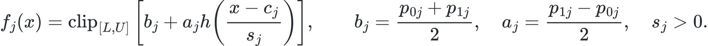

[LaTeX](docs/equations/response-6-2-01.tex)

Both plateaus $p_{0j},p_{1j}\in[L,U]$ are learned from WT and are the limits as $x\to-\infty,+\infty$, respectively. Activation and repression are allowed; the plateaus are not forced to $L,U$. Let $r=\max(x_{\max}-x_{\min},10^{-8})$. Constraints are $c_j\in[x_{\min}-r,x_{\max}+r]$ and $s_j\in[10^{-6}r,100r]$, with actual optimization variables $(p_{0j},p_{1j},c_j,\log s_j)$. SciPy least squares uses residuals $(f_j(x_{ij})-y_i)/D$, equivalent to minimizing:

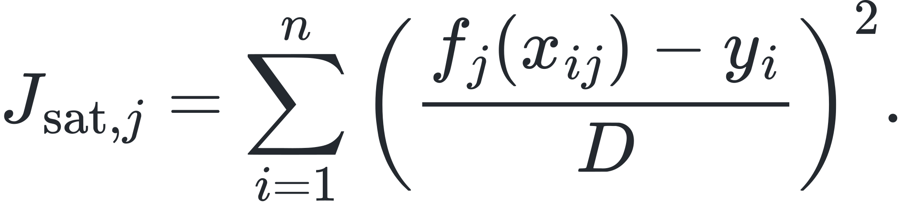

[LaTeX](docs/equations/response-6-2-02.tex)

There is no single-relation ridge. SciPy's reported cost is $1/2$ of this sum of squares. Within deterministic `det_starts` and `max_nfev` budgets, valid candidates are selected by WT MSE. The current `best_finite` policy can retain finite, bounded candidates after budget exhaustion while recording `solver_converged=False`, raw solver status, and evaluation count. Numerical failures are excluded.

### 6.3 NN singles: independent bounded networks

For $d$ inputs, define the following network; singles use $d=1$, groups use $d=2$ or $3$:

```math
u_j=\frac{x_j-\mu_j}{s_j},\qquad
f_\theta(x)=L+D\,\sigma\!\left[v^\top\tanh(Wu+b)+c\right].
```

$\mu_j$ and $s_j$ are the fitted WT input mean and population standard deviation (`ddof=0`); zero standard deviations are safely replaced by $1$. They are stored as model constants and not recomputed for queries. $W\in\mathbb R^{H\times d}$, $b,v\in\mathbb R^H$, and $c\in\mathbb R$. Let $\theta$ concatenate **all** elements of $W,b,v,c$, giving $p=H(d+2)+1$ parameters. Training and best-snapshot selection use the same objective:

```math
J_{\rm NN}(\theta)=\frac1n\sum_{i=1}^n\left(\frac{f_\theta(x_i)-y_i}{D}\right)^2
+\lambda_{\rm NN}\frac{\|\theta\|_2^2}{p}.
```

Biases are penalized; WT normalization means / scales are not. Current `nn_response` settings are `hidden_width: 4, epochs: 300, lr: 0.01, l2: 0.01, seed: 42, restarts: 1`. Adam trains on all WT rows, retaining the best objective snapshot across epochs / restarts, without an independent validation set. Training uses Torch CPU float64 and limits Torch threads during worker initialization. Inference and immutable-model validation use NumPy, without CUDA. Completing fixed epochs is not solver convergence; NN restarts are independent of the saturation budget.

### 6.4 spline singles: cubic latent splines and exponential tails

Let $z=(x-x_{\min})/(x_{\max}-x_{\min})$. Within the WT range, the latent curve is $g(z)=\sum_k\theta_k B_{k,3}(z)$. $B_{k,3}$ are cubic B-splines with four repeated knots at each end. Internal knots are equal quantiles of normalized WT inputs, deduplicated and excluding endpoints. For any such curve, define the tail-extension operator:

```math
(T_\tau g)(z)=\begin{cases}
g(0)+\tau g'(0)(e^{z/\tau}-1), & z<0,\\
g(z), & 0\le z\le1,\\
g(1)+\tau g'(1)(1-e^{-(z-1)/\tau}), & z>1.
\end{cases}
\qquad f(x)=L+D\,\sigma((T_\tau g)(z)).
```

Values and first derivatives are continuous at the boundaries ($C^1$). The latent plateaus are $g(0)-\tau g'(0)$ and $g(1)+\tau g'(1)$. Sigmoid maps them to learned finite response plateaus, without forcing $L,U$; curves may be nonmonotonic. $x=0$ is a finite location in the nonnegative input domain and is not automatically the left-infinite plateau.

All derivatives and integrals are with respect to dimensionless $z$. The objective is:

```math
J_{\rm spline}(\theta)=\frac1n\sum_{i=1}^n\left(\frac{f(x_i)-y_i}{D}\right)^2
+\lambda_s\left[\int_0^1(g''(z))^2\,dz+\frac{g'(0)^2+g'(1)^2}{2\tau}\right].
```

The curvature integral uses 12-point Gauss–Legendre quadrature on each nonzero knot interval. The endpoint-slope term also equals the integrated squared curvature of the exponential tails above. There is no additional single-relation ridge. Initialization fits a design-matrix least-squares solution to logits of normalized WT output clipped to $[10^{-4},1-10^{-4}]$; further starts add Gaussian perturbations with a fixed seed.

Current settings are `smoothness: 1e-6, tail_scale: 0.5, internal_knots: 2, max_nfev: 1000, restarts: 3, seed: 42`. These are experimental settings, not independently validated optimal defaults; production does not cross-validate each relation. Only successful finite solutions are accepted and ranked by the objective. With none, fitting fails; saturation's best-finite policy does not apply.

### 6.5 Two- / three-input groups: functions and penalties

Candidate group $G$ uses the two / three inputs with the highest WT singles scores. Ranking and input standardization are frozen on WT. Groups fit the entire $y$, not singles residuals. Let $M_G=n^{-1}\sum_i(F_G(X_{iG})-y_i)^2$.

**saturation groups** use WT population means / standard deviations to form $u_j=(x_j-\mu_j)/s_j$, then map a quadratic polynomial through softsign:

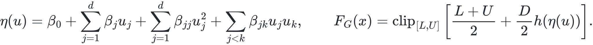

[LaTeX](docs/equations/response-6-5-01.tex)

There are $p=(d+1)(d+2)/2$ parameters, or $6/10$ for two / three inputs; all coefficients are bounded to $[-100,100]$. Least-squares residuals concatenate $(F_G-y)/(D/2)$ and $\sqrt{\lambda_r n/p}\,\beta$, equivalent to minimizing $M_G+P_G$, where:

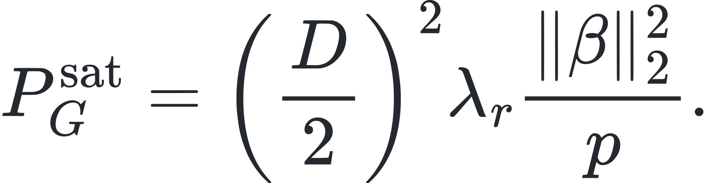

[LaTeX](docs/equations/response-6-5-02.tex)

This ridge **includes the intercept**, rather than penalizing only interactions or non-intercept terms. **NN groups** directly use the $d$-input network and objective in 6.3, with $p=H(d+2)+1$. In original output units, the penalty is:

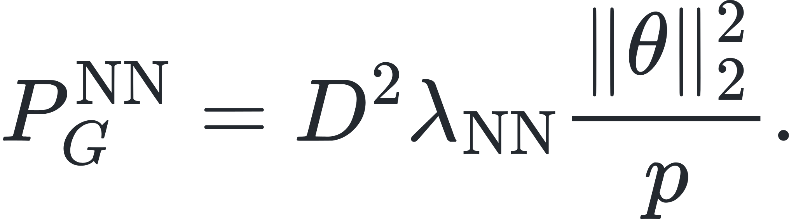

[LaTeX](docs/equations/response-6-5-03.tex)

**spline groups** first apply each input's WT min–max transformation to obtain $z_j$. Let $m_j=\operatorname{median}_i z_{ij}$. $N_{j1},N_{j2}$ are natural cubic interpolation bases at knots $(0,m_j,1)$, with respective values $(0,1,0)$ and $(0,0,1)$ and zero second derivatives at endpoints. Extend every basis with $T_\tau$ from 6.4 and define:

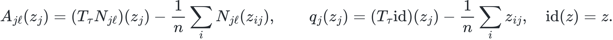

[LaTeX](docs/equations/response-6-5-04.tex)

Within $[0,1]$, $q_j$ is $z_j-\bar z_j$, with no additional standard-deviation scaling. Before centering, its left and right tails are $\tau(e^{z_j/\tau}-1)$ and $1+\tau(1-e^{-(z_j-1)/\tau})$. Group latent curves and outputs are:

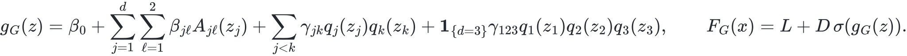

[LaTeX](docs/equations/response-6-5-05.tex)

Two- / three-input groups have $6/11$ parameters. Let $\gamma$ contain all pairwise and third-order interaction coefficients. Define the complete Hessian and boundary normal-slope penalty:

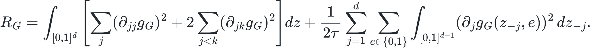

[LaTeX](docs/equations/response-6-5-06.tex)

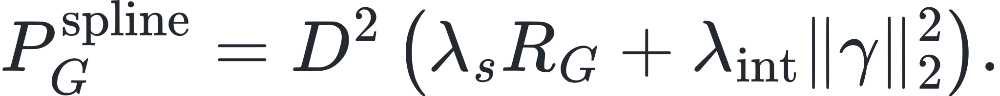

[LaTeX](docs/equations/response-6-5-07.tex)

The interaction penalty is a **sum** of squared coefficients, currently `group_interaction_penalty: 0.01`. $R_G$ uses 4-point Gauss–Legendre tensor-product quadrature over $[0,m_j]$ and $[m_j,1]$ in each coordinate, with face-normal coordinates fixed at $0/1$. The mixed-second-derivative coefficient is indeed $2$. Geometric group support separately uses WT mean / standard-deviation coordinates $u$; do not confuse these with the function bases' min–max coordinates $z$.

### 6.6 Frozen WT weights, group gain, and query routing

Let $r_i$ be target row indices, $t_{ij}$ each input's source bin, and $b_i$ the branch. After failed relations are removed, define adjacent pairs on common WT rows of the remaining singles:


[LaTeX](docs/equations/response-6-6-01.tex)

Only originally adjacent rows in the same branch are compared; rows are not sorted, and missing rows or branches are not bridged. Weights are neither Pearson coefficients nor training R²; they are the mean absolute adjacent change of the fitted response:

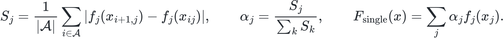

[LaTeX](docs/equations/response-6-6-02.tex)

If $\mathcal A$ is empty, all $S_j=0$. Failed relations have no weight (equivalently $\alpha_j=0$); WT scores / normalization are recomputed over retained relations. If the total score is zero, all weights are zero, the WT mean is returned with `no_information`, and groups are not fitted. **$\alpha$ is frozen during perturbation**, without renormalization for actual changes, enabled lags, or “active” inputs. Under singles routing:

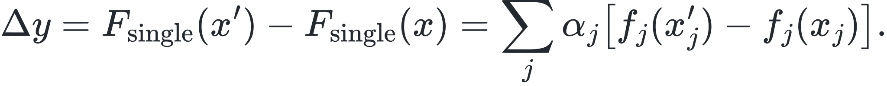

[LaTeX](docs/equations/response-6-6-03.tex)

Use frozen singles WT predictions as the comparison baseline, with $B=n^{-1}\sum_i(F_{\rm single}(X_i)-y_i)^2$. All three families use penalized group loss and gain in original $y$ units:

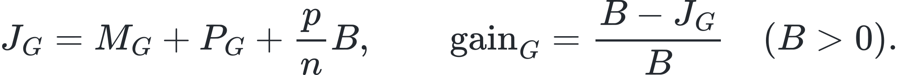

[LaTeX](docs/equations/response-6-6-04.tex)

The complexity term $pB/n$ is used for group selection / acceptance and does not change the optimum within a fixed group. For $B=0$, saturation / NN record gain $0$ and spline records $-1$; neither passes the current `min_penalized_gain: 0.05`. Multiple starts also check WT prediction spread $\max_i(\max_a\hat y_i^{(a)}-\min_a\hat y_i^{(a)})/D$. saturation / spline groups require every start to succeed finitely; NN uses finite best snapshots and does not treat fixed epochs as convergence evidence.

Candidate groups also check row counts, cell ESS, effective kernel rows, and global / branch geometry. If $W$ is the normalized weight matrix from common WT rows to cells and $\bar w=n^{-1}\sum_iW_{i:}$, the implementation uses:


[LaTeX](docs/equations/response-6-6-05.tex)

These are support indicators, not independent observation counts. Current settings are `min_group_rows: 24, min_group_cell_ess: 30, min_query_cell_ess: 10, min_group_effective_rows: 12, max_geometry_condition: 10000`. Every family requires $n_{\rm eff}\ge\max(12,2p)$. NN / spline also require $n\ge\max(24,2p)$; saturation requires $24$ raw rows. Rejection of all groups means current data and thresholds do not support a group; it does not automatically indicate a bug or justify relaxing production thresholds.

Queries try accepted groups in descending penalized gain. A group must cover all declared changed inputs, and every WT / perturbed row in the query batch must pass same-branch nearest-neighbor radius and local cell-ESS checks. If any row fails, try the next group or fall back to singles. A selected group **replaces the entire batch** with $\Delta y=F_G(x'_G)-F_G(x_G)$; singles and group corrections are not added. Groups have two / three inputs, but routing has no additional requirement that at least two actually change. One changed input can use a covering, supported group. Unchanged queries return identical WT / query responses.

Curves, weights, metrics, and checkpoints distinguish families. NN exports network parameters; spline exports knots / coefficients and configuration. Other-family parameters cannot be interpreted as saturation parameters. Bounded output or smooth extrapolation does not guarantee biologically reliable predictions outside WT. Failure of quality screening is not biological zero effect; training R² / RMSE and group gain are not independently measured predictive accuracy.

Configure joint interventions with `perturbation.joint_knockout` and each layer's family with its `response_model`. The root cell only establishes pseudotime origin; response inputs use the normalized units in sections 3 and 8.

<a id="perturbation"></a>
## 7. Perturbation engine and examples

### Analysis workflow and subnetworks

```text
Step 1  Configuration, raw RNA/ATAC, identity audit
Step 2  Independent reference QC/clustering, model views, axis alignment
Step 3  Official roots, joint pseudotime, and binning for each cohort
Step 4  peak→gene distance candidates and Granger
Step 5  peak→gene response fitting
Step 6  Motif / per-TF per-lag screening and TF→peak response fitting
Step 7  Quality-filtered network integration
Step 8  Gene / peak intervention and bin-wise forward propagation
Step 9  Cell endpoints, coverage, aggregation, optional projection, export
```

BFS extracts closure from the target along executable TF→peak→gene directions, applying R², lag, and endpoint filters. unlimited does not arbitrarily expand the entire network. Current final-edge and traversal-candidate-row budgets are both 250000; exceeding either raises an error. Finite depth restricts the neighborhood; graph depth is not a temporal lag.

### Gene KO and the target file

The target file has one token per line, optionally with a type. A single column defaults to TF:

```text
# Format example only
RUNX1
GATA1 TF
```

Stable IDs are recommended with GTF; unique symbols / fixed aliases also work. ALL expands after model GTF filtering and can create many interventions; interpret it together with joint_knockout. The current workflow rejects TARGET / coexpression-proxy TF interventions. A cofactor may be labeled TF through motif mapping.

joint_knockout=true constrains every target simultaneously; false runs them separately. Hybrid intervenes directly at the cell CP10k level according to ko_strength, then converts to model state. Direct targets remain constrained and are not reported again as downstream effects.

```text
Prepare WT / intervention cell states and frozen responses / weights
For each branch, move forward along pseudotime:
  Read TF(t-lag) changes → TF→peak response → peak(t) changes
  peak(t) → peak→gene response at the next gene bin
  Record events, support / bounds, and executable TF cascades
Reconstruct cell endpoints, report coverage, aggregate under the selected policy
```

Minimum TF-lag filtering does not renormalize α when it masks a relation. Feedback propagates only within the permitted graph / time structure and does not represent true steady-state dynamics. The current propagation_rounds=1; cell CP10k endpoints provide final readout. This workflow requires log_accumulation=true and rejects false.

### Log-space accumulation and endpoint reconstruction

Changes from multiple regulatory paths accumulate in L2 before a single transformation to L1, preserving signed addition. The endpoint transform is:

```text
L1' = expm1(log1p(L1_WT) + Σ ΔL2)
```

Symmetry in L2 does not imply symmetry in final CP10k effects. Check negative-L1 truncation and unavailable cell-endpoint states. Reconstruction is a forward mapping, not an exact inverse of binning, and does not recover raw UMI.

### Peak interventions

A peak is a second intervention entry point into the same network. Upstream TFs provide support reports only; peak changes are not interpreted backward as TF causal effects. depth=1 reports direct target genes; 2/3 allow downstream TF→secondary peak→gene propagation. state selects a cluster or all.

relative multiplies binary open proportions / continuous normalized counts by 1+s; s=-1 fully closes a peak. The continuous model changes counts before log1p, freezes full D, and does not renormalize other peaks. absolute sets a target value in current model units; it is not raw [0,1] in the continuous route.

For exact / overlap / nearest matching, inspect distances and actual matches. Peaks absent from the network do not automatically acquire a model. Lack of credible upstream support, expression / motifs, or supported interpolation cannot be read as true zero effect. The standalone CLI and unit table follow.

<a id="endpoints"></a>
## 8. Units, cell endpoints, and cross-cluster aggregation

Bin-wise `bin_forward` preserves branches, TF lags, peak→gene temporal advancement, and subnetwork closure. Joint KO keeps every direct target constrained and excludes direct targets from repeated downstream reporting. Gene KO strength operates at cell CP10k level. RNA / ATAC values in the continuous model cannot be multiplied, summed, or compared indiscriminately.

| State / field | Current definition |
|---|---|
| RNA L0 | Cell CP10k |
| RNA L1 | `log1p(CP10k)`; RNA input to TF→peak and model state |
| RNA L2 | `log1p(L1)`; peak→gene target `log1p_rna_log1p_cp10k` |
| Model ATAC | `normalized_atac_log1p` when the continuous view is enabled |
| Endpoint effect | log2FC from reconstructed WT / perturbed cell CP10k means |
| Merged `delta_rna_signed` | Signed merged effect; primary plotting field |
| `l0_log2fc_unclipped` | When exported, log2FC before display clipping; also inspect `display_clipped` |

After transforming L2 changes to L1, cell reconstruction floors negative values at zero, then recovers CP10k. Bin means need not equal reconstructed cell endpoints. `l1_floor_diagnostics.csv`, endpoint `status`, and upper / lower bound evidence identify flooring and unavailability. Zero means, nonfinite values, and missing endpoints are not ordinary zero effects.

Current `valid_cell_means` uses WT and perturbed means from **the same valid context / cell subset** for each gene, weights them by cell count, then computes `log2(perturbed mean/WT mean)` rather than averaging cluster log2FC. Quality-filtered, missing-endpoint, failed, and nonpositive-mean contexts are excluded from both sides with reasons recorded. Explicitly valid, unselected genes with equal WT / perturbed values in the quality-pruned network can supply unchanged baselines; assumptions and context counts are reported separately. Missing effects are not zero-filled.

Read `aggregation_scope` (`full/partial/unavailable`), `aggregation_used_cells`, `aggregation_total_cells`, `aggregation_excluded_cells`, `aggregation_cell_fraction`, context counts, and `aggregation_context_exclusions`. partial represents only the listed valid subset and cannot be generalized to every input cell. Optional `strict_complete` requires full coverage; section 12 describes diagnostic limitations.

Peak perturbation supports configuration and a standalone CLI, with relative / absolute modes, cluster states, depth, and coordinate matching, for example:

```bash
python run_peak_perturbation.py --config config.local.yaml --peak chr3:123400-123900 --mode relative --strength -1 --depth 2 --state all --out-dir results/my_peak_run
```

<a id="outputs"></a>
## 9. Outputs, caching, and recovery

All modes write directly to `output.dir`, without automatically appending `gene_ids`, `joint`, `atac`, or response-family directories. `checkpoint_dir: null` uses `output.dir/checkpoints`; per-cluster modeling uses corresponding subdirectories such as `cluster_N`. To switch modes or retain multiple runs, explicitly choose different output roots and compatible checkpoint directories. Later runs write same-named results; stale condition files are not automatically cleaned, and historical nested directories are not automatically searched or migrated.

| File | Contents |
|---|---|
| `hvg_genes.csv` | Actual model HVGs; independent of `save_intermediate` |
| `gene_identity.csv`, `gene_filter_report.csv`, `gene_target_resolution.csv`, `gene_identity_metadata.json` | Full-input identity, filtering, target resolution, GTF and mapping provenance |
| `cytotrace_scores_<context>.csv`, `cytotrace_provenance_<context>.json` | Official cohort scores, roots, full raw-count axes, source and R dependency evidence |
| `causal_peak_gene_edges.csv`, `tf_peak_weights.csv` | Two screened regulatory edge layers |
| `saturating_gene_metrics.csv`, `saturating_tf_metrics.csv` | WT fit and failure states |
| `saturating_response_weights.csv`, `saturating_response_curves.csv` | α, excluded relations, family-specific parameters |
| `saturating_support_diagnostics.csv`, `saturating_gates.csv`, `saturating_contexts.json` | Group support, gates, branches, context evidence |
| `saturating_endpoints.csv`, `saturating_aggregation_diagnostics.csv`, `l1_floor_diagnostics.csv` | Cell endpoints, coverage, flooring, unavailability reasons |
| `perturbation_results.csv`, `perturbation_merged.csv` | Per-context results and cross-context aggregation |
| `saturating_peak_attributions.csv`, `saturating_tf_peak_contributions.csv` | Event contributions in each layer's native units |
| `saturating_pathways.csv`, `perturbation_pathways.csv` | Shared temporal-event-link schema; headers retained for empty results |
| `aggregated_tf_peak_edges.csv`, `atac_changes.csv`, `atac_changes_merged.csv`, `atac_changes.bed` | TF / ATAC results where applicable |
| `perturbation_cell_projection.csv`, `perturbation_projection_summary.csv`, `perturbation_projection_branch_probabilities.csv` | Optional cell-trajectory projection |
| `perturbation_projection_bin_history.csv`, `perturbation_projection_bin_metadata.csv`, `perturbation_projection_events.csv` | Optional projection history, bins, events |
| `binning_contexts.json`, `intermediate/` | Applicable binning evidence and intermediate tables |

If `rna_clustered.h5ad` is saved, interpret its model axis and reference-coordinate provenance through `clustering_reference`; it cannot replace raw all-gene CytoTRACE input. Peak mode additionally exports `peak_perturbation_results.csv`, `peak_upstream_tfs.csv`, and, when available, `peak_upstream_tfs_merged.csv`. Availability depends on mode, results, and export switches; not every table is guaranteed in every run.

On rerun, the pipeline checks Step 4 / 5 / 6 inputs, response families, configuration, and references against saved results. Upstream changes require affected downstream stages to be recomputed. On incompatibility, choose a new `output.checkpoint_dir`, or back up and move the indicated stage and downstream files before rerunning. Do not edit cache version numbers to bypass checks. The program does not automatically migrate or delete disk caches. Load pickle files only from trusted sources.

Motif scanning and response fitting support parallel execution and terminal progress; results record fitting budgets and convergence. Revalidate caches after resource-content changes and avoid modifying shared references during a run. `workers: 24` controls fitting processes; perturbation Step 8 is single-process.

### Additional outputs and motif reuse

The original workflow's `rna_clustered.h5ad`, `cluster_top50_genes.csv`, `atac_changes_significant.bed`, `atac_changes_significant_merged.bed`, and `peak_perturbation_report.txt` remain useful where applicable. Markers help inspect cluster mapping, BED files support coordinate / IGV comparisons, and peak reports include targets, upstream support, direct effects, and summaries. Do not assume every run generates them.


| Cache under output.cache_dir | Evidence and reuse limits |
|---|---|
| peak_motif_raw_v1/<scan_key>.pkl | Complete pre-top-N threshold-passing hits and successful zero hits; verifies genome, PWM / mappings, threshold, implementation |
| peak_family_motif_v2/<scan_key>.pkl | Independent family scan; candidates do not replace actual DNA evidence |

Contexts reconstruct candidates from raw hits. Changing top-N does not require rescanning complete raw caches. Extraction failures / missing sequences are not negatives; partial coverage scans only missing peaks. Old family v1 is not migrated automatically; the first v2 scan is cold.

The current 24 fitting workers control Step 5/6; 24 main motif workers control only missing main scans, not family scans or NN epochs. Actual processes depend on CPU / task count, and full cache hits do not create a scan pool. With threadpoolctl available, each fit worker limits underlying libraries to one thread. Worker failure aborts without saving a partial registry. Startup costs can outweigh parallel gains on small tasks.

Python multiprocessing callers need an `__main__` guard; use workers=1 in daemon processes. Worker count is a runtime parameter and normally does not invalidate scientific checkpoints. Changes to NN restarts / spline starts / solver budgets must distinguish scientific contracts from actual computation cost.

<a id="visualization"></a>
## 10. Visualization and pathway interpretation

Pathways use a **radial cluster hierarchy**, with a separate panel for each selected gene. Effect / fit scatterplots, distributions, heatmaps, TF hierarchies, and trajectory projections read the result directory. See [FIGUERS_README.md](FIGUERS_README.md) for units and filtering.

```bash
Rscript visualize_perturbation.R results/my_run
Rscript visualize_perturbation.R --result-dir results/my_run --output-dir results/my_run/figures_custom --genes ENSG00000123456
python plot_causal_network.py 5 --result-dir results/my_run --output-dir results/my_run/network_figures
```

R configuration precedence is CLI > `CAUSALBRIDGE_RESULT_DIR` / `CAUSALBRIDGE_OUTPUT_DIR` / `CAUSALBRIDGE_PATHWAY_GENES` > manual settings at the script top. `PATHWAY_GENES` / `--genes` accept stable IDs or display names; use IDs for duplicate names. Automatic selection uses finite `|delta_rna_signed|` and `TOP_PATHWAY_N`; `--genes __AUTO__` restores it. Manual selection can retain unavailable-effect genes with their status. Absent genes trigger warnings or errors. Images default to `figures_R` under the final input directory.

Adapters join by ID and label with symbols. A path label `cluster_0` is aligned only when results actually contain corresponding `0`; distinct clusters must not be merged. Python network plotting likewise recognizes the current schema, units, and signed effects. The effect / fit plot's y-axis is R², not a p-value. Missing values are not stable or zero effects.

Hybrid pathways temporally link nonzero TF→peak events and nonzero events at the next gene bin within the same branch / context / intervention, exporting `pathway_type=temporal_event_link`, `causal_claim=False`. Native contributions describe their own layer only. Multiple TFs passing through one peak can share the same peak→gene response; this is not TF-exclusive allocation of RNA effects. Complete `endpoint_delta_rna_log2fc` is a shared gene endpoint and cannot be summed over TF paths. Historical RNA-allocation fields such as `delta_r_raw_sum` / `delta_r_total` remain NaN / unavailable. Figures do not invent flows or add different-layer units.

<a id="configuration"></a>
## 11. Configuration reference

Current values below come from the supplied config.yaml and do not represent every API default. Table headings identify parent nodes; dotted keys are relative children. Paths use portable examples. Copy and edit the full repository configuration for a complete run rather than assembling these fragments alone.

### input and cytotrace

| input parameter | Current value / entry | Meaning |
|---|---|---|
| gene_identity_mode | gtf_gene_id | Alternatively legacy |
| annotation_gtf | /path/to/genes.gtf.gz | Required in GTF mode |
| rna_gene_id_column | gene_ids | RNA stable-ID column |
| rna_h5ad | /path/to/rna.h5ad | Raw RNA |
| atac_h5ad | /path/to/atac.h5ad | Raw ATAC |
| genome_fasta | /path/to/genome.fa | Motif reference |
| target_genes | /path/to/targets.txt | Targets for gene mode |

| cytotrace parameter | Configuration | Meaning |
|---|---|---|
| official_source_dir | Optional ../CytoTRACE_official | Pinned official source |
| rscript_binary | Replace / remove the supplied absolute path | Rscript in the same environment |
| r_library_dir | As above | R package library in the same environment |
| native_library_dir | As above | Native libraries in the same environment |
| seed | Optional 42 | Seed for the official run |

### preprocess

| Parameter | Current value | Meaning |
|---|---|---|
| rna.min_cells_per_gene | 50 | Minimum cells detecting a gene |
| rna.min_umi_per_cell | 500 | Reference-cell RNA QC |
| rna.n_highly_variable_genes | 3000 | Consult the export for actual HVGs |
| atac.min_cells_per_peak | 10 | Minimum cells with an open peak |
| atac.min_peaks_per_cell | 1000 | Minimum open peaks per cell |
| atac.binarize | true | Binary reference QC |
| atac_depth_normalization.enabled | true | Continuous hybrid view |
| atac_depth_normalization.target_sum | 10000 | Depth-normalization scale |
| atac_depth_normalization.output_cap_expansion | 0.25 | log1p WT-span expansion |

### clustering

| Parameter | Current value | Meaning |
|---|---|---|
| enabled | true | Reference clustering / modeling by cohort |
| cluster_key | leiden | Label column |
| n_neighbors | 20 | Reference-graph neighbors |
| n_pcs | 20 | Reference PCs |
| resolution | 0.5 | Leiden resolution |
| random_state | 42 | Seed |
| min_cells_per_cluster | 50 | Small-cluster fallback threshold |
| fallback_pseudotime_method | palantir | Fallback method |
| paga.enabled | false | Optional lineage merging |
| paga.connectivity_threshold | 0.08 | Connectivity threshold |
| paga.min_cells_per_lineage | 50 | Lineage support |

### pseudotime

| Parameter | Current value | Meaning |
|---|---|---|
| method | dpt | dpt / palantir |
| n_neighbors | 20 | Joint-graph neighbors; may adapt to cohort |
| root_cell_marker | null | Explicit root marker |
| root_cell_method | cytotrace | cytotrace / marker / min_umi / auto |
| cytotrace_n_top_genes | 200 (ignored) | Compatibility field |
| n_bins | 50 | Maximum bins in the fixed route |
| min_cells_per_bin | 10 | Target support |
| smooth_kernel | gaussian | gaussian / hard |
| smooth_overlap_factor | 2 | Gaussian overlap constraint |
| ablation_shuffle_pseudotime | false | true is unsupported in this workflow |
| adaptive_binning.enabled | false | Shared-plan switch |
| adaptive_binning.bandwidth_selection | state | state / ess; see section 4 |
| adaptive_binning.boundary | split_noise | Alternatively none |
| adaptive_binning.state_modality | rna | Alternatively joint; state decisions only |
| adaptive_binning.embedding.n_components | 5 | Maximum PCs per modality |
| adaptive_binning.embedding.max_features | 512 | Feature budget per modality |
| adaptive_binning.embedding.max_dense_elements | 2000000 | Total dense-element budget |
| adaptive_binning.embedding.random_seed | 42 | Fixed embedding seed |

Optional BinningConfig parameters live directly under pseudotime.adaptive_binning. These are standalone-object defaults; the pipeline can derive some values. Final plan diagnostics are authoritative:

| Optional key | Standalone default | Meaning |
|---|---|---|
| mode / branch_policy | adaptive_gaussian / separate | Algorithm / branches |
| max_bins / min_cells_per_bin | 100 / 5 | Plan size |
| target_bins / overlap_factor | null / null | Explicit overrides |
| min_support_cells / target_ess | 5 / 40 | Support / ESS target |
| bandwidth_multipliers | [0.25,0.5,1,2] | Candidate bandwidths |
| max_bandwidth_multiplier | 2 | Upper limit |
| state_budget / state_floor_fraction | 1 / 0.2 | State heuristics |
| state_uncertainty_multiplier | 2 | Uncertainty factor |
| state_pilot_subdivisions / state_min_pilot_cells | 4 / 4 | Pilot support |
| state_bootstrap_repeats | 32 | Bootstrap |
| boundary_splits / boundary_min_side | 20 / 10 | Boundary support |
| boundary_stability | 0.8 | Boundary-stability threshold |
| random_seed / max_kernel_elements | 42 / 2000000 | Seed / kernel budget |

### granger

| Parameter | Current value | Meaning |
|---|---|---|
| distance_thresh | 200000 | Peak midpoint–TSS distance in bp |
| significance_threshold | 0.01 | Base p threshold |
| correction_method | fdr_bh | Multiple-testing correction |
| min_effect_size | 0.1 | Partial R² form |
| soft_threshold | true | Composite screening |
| min_composite_score | 0.3 | Base score threshold |
| composite_weights | [0.4,0.6] | p / effect weights |
| max_lag | 1 | Current one-step test |
| reference_bins | 50 | Reference for df heuristic |
| ablation_lag0 | false | Contemporaneous ablation |

### atac_to_rna and independent responses in each layer

| atac_to_rna parameter | Current value | Meaning |
|---|---|---|
| model_mode | saturating_hybrid | Only supported mode; also the missing-key default |
| response_model | nn | peak→gene response |
| log_normalize_rna | true | L1→L2 log1p |

Each layer has independent nn_response / spline_response settings under atac_to_rna and rna_to_atac, active only when that family is selected:

| Child key in each layer | Current value in both layers | Meaning |
|---|---|---|
| nn_response.hidden_width | 4 | Independent hidden layer |
| nn_response.epochs | 300 | Fixed budget |
| nn_response.lr | 0.01 | Adam learning rate |
| nn_response.l2 | 0.01 | Parameter penalty |
| nn_response.seed | 42 | Seed |
| nn_response.restarts | 1 | Independent restarts |
| spline_response.smoothness | 1e-6 | Experimental smoothing penalty |
| spline_response.group_interaction_penalty | 0.01 | Group interaction penalty |
| spline_response.tail_scale | 0.5 | Tail scale |
| spline_response.internal_knots | 2 | Internal knots |
| spline_response.max_nfev | 1000 | Budget per start |
| spline_response.restarts | 3 | Starts |
| spline_response.seed | 42 | Seed |

### atac_to_rna.saturating_hybrid

These are shared fitting / support settings for both layers; they do not require both layers to select saturation:

| Parameter | Current value | Meaning |
|---|---|---|
| workers | 24 | Target-fitting processes |
| max_nfev | 500 | saturation budget |
| budget_exhausted_policy | best_finite | Saturation exhaustion policy; exclude if omitted |
| det_starts | 3 | saturation starts |
| rna_cap_lambda | 0.25 | RNA WT-span cap |
| min_fit_rows | 12 | Rows per target |
| group_sizes | [2,3] | Input-group sizes |
| max_groups | 2 | Candidate-group count |
| polynomial_degree | 2 | Corresponding group-response complexity |
| ridge | 0.1 | Corresponding group regularization |
| min_group_rows | 24 | Minimum observation rows |
| min_group_cell_ess | 30 | Cell ESS |
| min_query_cell_ess | 10 | Query ESS |
| min_group_effective_rows | 12 | Effective kernel rows |
| max_geometry_condition | 10000 | Maximum geometry condition number |
| support_radius_quantile | 0.95 | Support-radius quantile |
| min_penalized_gain | 0.05 | Penalized gain |
| restart_prediction_spread_max | 0.05 | Restart prediction spread |
| query_neighbors | 10 | Query-support neighbors |

### rna_to_atac

| Parameter | Current value | Meaning |
|---|---|---|
| response_model | spline | TF→peak response |
| motif_db | jaspar2024 | Motif resource |
| motif_scan_workers | 24 | Main-scan processes |
| motif_pval_threshold | 0.1 | Coarse candidate screening |
| max_tfs_per_peak | 5 | Main-candidate top-N |
| tf_peak_pvalue_threshold | 0.05 | Pearson threshold |
| min_abs_contribution | 0.01 | abs(weight)*std(X) |
| tf_expression_filter | true | Presence on input axis |
| time_lag | true | false forces contemporaneous inputs |

### perturbation

| Parameter | Current value | Meaning |
|---|---|---|
| knockout_type | gene | gene / peak |
| perturbation_mode | bin_forward | Current propagation entry point |
| joint_knockout | true | Joint multiple targets |
| ko_strength | 1 | Gene KO strength |
| subnetwork_depth | unlimited | Executable downstream closure / finite integer |
| subnetwork_unlimited_max_edges | 250000 | Final-edge limit |
| subnetwork_unlimited_max_work_edges | 250000 | Traversal-candidate limit |
| min_r2_threshold | 0.3 | peak→gene quality |
| min_lag_per_peak_filter | true | Minimum TF lag per peak |
| log_accumulation | true | Must be true for hybrid |
| min_delta_threshold | 0 | Implementation still enforces at least 1e-6 |
| atac_significance_zscore | 2 | Screening relative to WT variation |
| aggregation_policy | valid_cell_means | Alternatively strict_complete |
| cell_projection.enabled | true | RNA projection |
| cell_projection.n_components | null | All estimable PCs |
| cell_projection.n_neighbors | 20 | Neighbors |
| cell_projection.history_delta_threshold | 1e-8 | Sparse-history threshold |
| cell_projection.state_unit | rna_log1p_cp10k | Projection units |
| peak_ko.peak_id | Machine-specific example; replace | Target coordinates |
| peak_ko.mode | relative | Alternatively absolute, in model units |
| peak_ko.strength | -1 | Fully close |
| peak_ko.state | all | Alternatively a cluster |
| peak_ko.depth | 2 | 1 direct; 2/3 cascade |
| peak_ko.match | overlap | exact / overlap / nearest |

If the traversal budget is omitted, it derives as max(max_edges*10,max_edges+100). Candidate rows differ from final edges.

### output and missing-key fallbacks

| output parameter | Current configuration | Meaning |
|---|---|---|
| dir | Machine-specific path; replace | Results written directly here |
| cache_dir | Machine-specific path; replace | Motifs / shared resources |
| checkpoint_dir | null | output.dir/checkpoints |
| save_intermediate | true | Does not control actual-HVG export |

Important missing-key values follow. Reducing the configuration to minimal paths does not guarantee the same experiment:

| Parameter | Library / code value when omitted |
|---|---|
| input.gene_identity_mode | legacy |
| preprocess.atac_depth_normalization.enabled | false |
| atac_to_rna.model_mode | saturating_hybrid |
| response_model in both layers | saturation |
| hybrid workers | 1 |
| saturation budget_exhausted_policy | exclude |
| pseudotime.n_neighbors / n_bins | 30 / 100 |
| adaptive_binning.state_modality | joint |
| granger.distance_thresh | 1000000 |
| granger.significance_threshold / min_effect_size | 0.10 / 0.02 |
| rna_to_atac.motif_pval_threshold / motif_scan_workers | 1e-4 / 1 |
| rna_to_atac.max_lag | 0 (automatic route) |
| perturbation.aggregation_policy | strict_complete |
| cell_projection.enabled / n_neighbors | false / 10 |
| clustering.resolution | 0.8 |
| clustering.paga.enabled / connectivity_threshold | false / 0.1 |
| output.dir / cache_dir | results/ / cache/ |

<a id="validation"></a>
## 12. Limitations and interpretation

### Time settings

To fit contemporaneous relationships, use the following configuration. It preserves normal pseudotime order and sets both layers to lag=0:

```yaml
granger:
  ablation_lag0: true
pseudotime:
  ablation_shuffle_pseudotime: false
rna_to_atac:
  time_lag: false
```

Shuffled pseudotime is unsupported in this workflow. Lag denotes relative positions between bins, affected by bin width and window overlap; it cannot directly represent real-time delay. A fixed seed helps reproducibility with the same inputs, parameters, and library environment.

### Known issues

Interpret support, coverage, and diagnostic files in light of these limitations:

- **Current reference projection** uses all estimable PCA components and cell reconstruction. However, code treats `min(n_genes,n_cells-1)` as “full rank”; when genes outnumber cells, it may disable residual OOD and mark changes outside the PCA subspace as available. Projection `ok`, branch, and pseudotime do not establish absence of OOD. The reference fingerprint also does not fully bind the matrix, cell axis, branches, and time, so that field alone cannot establish reference consistency.
- **NN support groups** use a fixed `1e-10` tolerance on standardized reference mean / variance, which can raise an exception for legitimate narrow input ranges; automatic fallback is not guaranteed. Retain original model files. After model modification, provenance checks do not replace evaluation of actual fit quality.
- **Current aggregation threshold** retains an effect-filter floor of at least `1e-6` even with `min_delta_threshold: 0`; configuration comments saying “0 means no filtering” do not describe actual behavior. Nonpositive endpoints cannot produce finite log2 ratios. Inspect coverage exclusions and unchanged-baseline assumptions individually.
- **Current nonadaptive binning boundaries** can fail in qcut when pseudotime is constant. Interpret Gaussian overlap and multibranch support carefully. The optional multibranch route still has an empty-collection concatenation problem when every branch is too small.
- **Input compatibility / optional entry points**: legacy coordinates mixing known / unknown strands can affect negative-strand candidates through TSS fallback. Some `strict_complete` cases with missing coverage and earlier effect filtering lose diagnostics. Compatibility projection and binning-operator checks do not cover every invalid input.

<a id="modules"></a>
## 13. Modules and method sources

```text
CausalBridge/
├── run.py                      Pipeline, cohort modeling, recovery
├── io.py                       Configuration, data, outputs
├── preprocess.py               QC, normalization, clustering tools
├── gene_identity.py            GTF, stable IDs, aliases, TSS
├── reference_clustering.py     Independent reference and provenance
├── cytotrace.py                Official source, counts, R contract
├── cytotrace_runner.R          Calls the official algorithm
├── granger.py                  Pseudotime, binning, Granger
├── adaptive_binning.py         WT plans and support
├── binning_adapter.py          Shared-plan / embedding adapter
├── atac_normalization.py       Full-depth continuous ATAC
├── kinetics.py                 Layer scheduling, motifs, Pearson
├── saturating_hybrid.py        Hybrid settings, saturation, support
├── saturating_transfer.py      Layer registries and fitting
├── nn_hybrid.py                Independent CPU NN / group responses
├── spline_hybrid.py            Bounded splines, tails, interactions
├── saturating_perturbation.py  Hybrid intervention and cell endpoints
├── saturating_pathways.py      Temporal event links
├── saturating_projection.py    Hybrid projection adapter
├── perturbation.py             Intervention dispatch and subnetworks
├── reference_projection.py     Reference-projection tools
├── _wt_aggregation.py          Shared WT adapter
└── terminal_progress.py        Terminal progress

run_example.py                  Main CLI; positional configuration
run_peak_perturbation.py         Peak-intervention CLI
convert_10x_to_CausalBridge.py   10x conversion
plot_causal_network.py          Python network plots
visualize_perturbation.R        R effects, radial pathways, projection
config.yaml                    Complete parameters
target_genes.txt               Target list
FIGUERS_README.md              Figure definitions
scripts/                       Diagnostic helper scripts
tests/                         Unit and synthetic behavioral checks
```

Methods and resources:

- [Official CytoTRACE repository](https://github.com/gunsagargulati/CytoTRACE): the 2020 method and pinned 0.3.1 source; cite the original algorithm and actual version.
- [Scanpy DPT](https://scanpy.readthedocs.io/en/stable/generated/scanpy.tl.dpt.html), [Palantir](https://github.com/dpeerlab/Palantir): pseudotime methods; this project prepares root selection and joint representation.
- [JASPAR](https://jaspar.elixir.no/), [gimmemotifs](https://github.com/vanheeringen-lab/gimmemotifs): record actual motif / mapping versions.
- [regulatory_pseudotime_design.md](regulatory_pseudotime_design.md): research-design discussion; current code / this guide define execution semantics.

This repository has no separate LICENSE file. External dependency licenses are not the project's license. For publication / reuse, record actual methods, assembly, databases, software, and input provenance; do not invent a project citation.

<a id="changelog"></a>
## 14. Release history

The v2.0 entries below describe the current implementation, followed by all 51 historical version records and technical updates from v1.40 through v0.3. Historical records describe behavior at the time; removed models, root-baseline scaling, and dependency instructions are not current features or installation requirements. The corresponding main sections define current algorithms, units, and configuration.

### v2.0 / 2.0.0

v2.0 provides stable gene IDs, independently bounded responses in both layers, a continuous ATAC model view, and cell-endpoint aggregation. Existing results must be rerun with the intended configuration to reflect these features.

#### v2.0-01: Enabled route and principal behavior changes

This release connects gene identity, reference views, response functions, cell endpoints, and provenance checks into an auditable workflow. The table describes explicit settings in the supplied [config.yaml](config.yaml). Compatibility defaults for omitted keys can differ; see [section 11](#configuration).

| Module | Historical behavior / compatibility route | Current configuration and changes |
|---|---|---|
| Gene axis | Input names and legacy coordinates remain optional | `gtf_gene_id`: stable-ID computation, symbol display, authoritative GTF coordinates |
| Root selection | Historical global mapping or approximate scores | Official CytoTRACE 0.3.1 in each actual modeling cohort |
| Response | Legacy shared PairEmbeddingNN | Hybrid; `nn` for peak→gene, `spline` for TF→peak |
| ATAC | Binary open proportions | Continuous log1p model view normalized by full input depth |
| Binning | Fixed Gaussian smoothing | Fixed gaussian remains enabled; shared adaptive plan explicitly disabled |
| Aggregation | Historical effect aggregation | `valid_cell_means`, reporting the same valid cell set and exclusion reasons |
| Result directory | Previously mode-dependent directory conventions | Direct `output.dir`; users explicitly separate runs |

`saturating_hybrid` is the only supported model and the missing-key default. It names the singles / supported-group workflow and does not require saturation in both layers. Legacy coordinate compatibility for gene identity is distinct from the removed model. After changing identity axes, ATAC representation, roots, or response families, revalidate scientific checkpoints rather than reusing old curves and effect tables directly.

#### v2.0-02: GTF stable IDs, duplicate symbols, and complete identity audits

Added `input.gene_identity_mode: gtf_gene_id`, auditing all input features before model filtering and removing only trailing numeric stable-ID versions. Collisions after normalizing versioned and unversioned IDs raise explicit errors rather than silently summing counts. Features unmatched to GTF retain filtering reasons; original H5AD files remain unchanged.

Model edge keys, fitting, projection feature axes, and cross-cluster merging use stable IDs. CSV saving adds name and display fields only in copies. Different IDs sharing a name receive fixed numbered aliases ordered by stable ID in the complete reference; HVG or cluster subsets do not renumber them. Motifs still match native symbols and expand to allowed IDs.

Targets and explicit root markers accept stable IDs, versioned IDs, unique symbols, and resolved numbered aliases. Ambiguous symbols must be specified explicitly. Added `gene_identity.csv`, `gene_filter_report.csv`, `gene_target_resolution.csv`, and `gene_identity_metadata.json` for identity, eligibility filtering, target resolution, and provenance. See [gene_identity.py](CausalBridge/gene_identity.py), [identity tests](tests/test_gene_identity.py), and [model identity tests](tests/test_gene_identity_modeling.py).

#### v2.0-03: Authoritative gene spans, coordinate conversion, and strand-aware TSS

GTF mode uses the complete gene-record span rather than incomplete or inconsistent input start / end coordinates. It converts 1-based closed intervals to 0-based half-open intervals and retains old coordinates in `original_*`. Positive-strand TSS is the converted start; negative-strand TSS is the converted end minus one.

This directly changes peak-midpoint–TSS distance candidates, especially on the negative strand; the current threshold is 200000 bp. Coordinate corrections require candidates and downstream models to be recomputed. This remains a single gene-level TSS approximation, without transcript-specific promoters; mixed unknown-strand legacy fallback limitations remain. See [gene_identity.py](CausalBridge/gene_identity.py) and [test_strand_tss.py](tests/test_strand_tss.py).

#### v2.0-04: Independent reference clustering, model normalization, and actual-HVG export

To prevent model GTF eligibility from redefining reference clusters, existing QC / HVG / target retention and RNA clustering first run on an original-RNA copy before GTF filtering. Model RNA is prepared independently. ATAC is preprocessed once. The model does not repeat cell QC after reducing its gene axis; it strictly aligns reference barcodes and separately records reference-coordinate and model-axis provenance.

Model normalization denominators and raw-count HVG ranking use **all GTF-eligible genes**, followed by the current 3000 HVGs and required targets / root markers passing expression QC. Additional non-HVG retention does not set `highly_variable` to true. Step 6 TF-presence checks can access the full eligible input axis, avoiding confusion between “non-HVG” and “absent from RNA input.”

`hvg_genes.csv` is independent of `save_intermediate` and contains only actual HVGs, with `gene_id`, `gene_name`, and available original names. Reference `X_pca` / `X_umap` provenance is recorded in `uns['clustering_reference']`; these cannot be read as PCA loadings on the model stable-ID axis. See [reference_clustering.py](CausalBridge/reference_clustering.py), [run.py](CausalBridge/run.py), and [HVG-order checks](tests/test_identity_hvg_order.py).

#### v2.0-05: Official CytoTRACE per cohort and complete raw-RNA transfer

Replaced approximate scores and global score mapping. Each actual modeling cluster / lineage runs official GCS→NNLS→diffusion on QC-retained cohort cells × raw RNA counts for **all genes**. Zero-expression genes remain for official internal filtering. Model HVGs, model log expression, and unverified input `obs` scores are not used. Separate cohort runs do not establish a common global score scale.

Pinned official 2020 / 0.3.1 source commit `f4ff6c0ab93cc704eef44e17adcd5c6baf09703a`, verifying `R/CytoTRACE.R` SHA256 `7dafcfa42c792eaffe1048f4716cb54105b31f2ad01c4f0c26868c10593b155d`. Sparse integer MatrixMarket transfer checks order and count sums on both axes. Fixed settings are `batch=NULL, enableFast=FALSE, ncores=1, subsamplesize=1000`; returned scores must be finite and cell-aligned.

Score argmax selects the root; subsequent DPT / Palantir still uses the joint representation. Explicit marker, min_umi, and auto routes remain. `cytotrace_n_top_genes` is read only for compatibility. Official failure raises an error rather than falling back to approximate CytoTRACE or fabricated global caches. See [cytotrace.py](CausalBridge/cytotrace.py), [cytotrace_runner.R](CausalBridge/cytotrace_runner.R), and [official root tests](tests/test_official_cytotrace.py).

#### v2.0-06: R, package libraries, and native libraries in one conda environment

Completed R installation instructions for the `CausalBridge` conda environment. Direct-source core dependencies include Matrix, HiClimR, ccaPP, and nnls; Rcpp / ncdf4 and transitive or native dependencies such as pcaPP, robustbase, and netCDF must resolve in the same environment. Installing the complete official R package additionally requires every `DESCRIPTION` Imports dependency, including Bioconductor `sva`. Sourcing pinned code and installing the full package differ; `pip install` does not install R dependencies.

The runner prioritizes configured Rscript. Otherwise, conda Python uses its own environment's `bin/Rscript`; other environments search PATH. Package and native libraries bind to the selected Rscript environment's `lib/R/library` and `lib`, without mixing environments. Startup clears inherited `R_HOME`, `R_ARCH`, and `R_LIBS`, sets `R_LIBS_SITE` / `R_LIBS_USER` / `LD_LIBRARY_PATH`, and uses `--vanilla`.

R loading failures retain package names and underlying messages; Python exceptions include selected Rscript and R output to distinguish missing namespaces, shared libraries, and source-validation failures. Relative source paths resolve from the repository root. Replace or remove personal absolute runtime paths after copying configuration; YAML `$CONDA_PREFIX` has no guaranteed shell expansion. See [section 2](#installation) and [cytotrace.py](CausalBridge/cytotrace.py). Installation verified on one machine does not guarantee dependencies elsewhere.

#### v2.0-07: Granger SSE and tail-probability corrections with screening retained

Fixed squaring `lstsq` residuals again: the returned values already represent SSE and are now summed directly. The standard one-step model still compares reduced / full models containing self-lag on identical valid rows, using `F=((SSE_r-SSE_f)/1)/(SSE_f/(n-3))`. Tail probability now uses `scipy.stats.f.sf` to avoid numerical loss in `1-cdf`. The lag-0 ablation receives the same correction with n-2 degrees of freedom.

`delta_r2=1-SSE_f/SSE_r` is explicitly a partial R² form, not an ordinary R² difference. Low variance, low SSE, rank-deficiency, and valid-row skip rules remain. Current `fdr_bh`, base p threshold 0.01, effect threshold 0.1, soft-score weights 0.4 / 0.6, base composite threshold 0.3, and historical degrees-of-freedom scaling remain active.

The correction can change selected edges and downstream perturbations. It does not biologically calibrate old thresholds or automatically recompute existing results. Correlated bins, candidate selection, and soft screening still limit overall BH interpretation; historical `is_causal` does not establish intervention causality. See [granger.py](CausalBridge/granger.py), [test_granger_sse.py](tests/test_granger_sse.py), and [section 5](#edges).

#### v2.0-08: Fixed smoothing retained; shared adaptive binning explicitly optional

Fixed gaussian remains configured. `n_bins: 50` is an upper limit, adapted to cohort size and `min_cells_per_bin: 10`; `smooth_overlap_factor: 2` constrains overlap. Optional shared adaptive binning freezes one WT plan for Granger, both response fits, and perturbation, aligning centers, membership weights, and branch lag pairing instead of rebinning between stages.

Currently `adaptive_binning.enabled: false`. When enabled, state / ess bandwidth and split_noise / none boundaries are available; the supplied settings are state, split_noise, rna. `state_modality: rna` restricts only state / boundary decisions and does not remove ATAC from joint pseudotime. Budgets of 5 PCs, 512 features per modality, and 2000000 total dense elements limit embedding cost; excess raises an error.

`binning_contexts.json` and per-context diagnostics retain ESS, support, bandwidths, and boundaries. Kernel participation, cell ESS, and effective kernel rank do not add independent samples; synthetic checks do not establish real-data optimality. Shared adaptive binning and hybrid do not support shuffle ablation. See [adaptive_binning.py](CausalBridge/adaptive_binning.py), [binning_adapter.py](CausalBridge/binning_adapter.py), and [section 4](#pseudotime).

#### v2.0-09: Independent response families and solver budgets in both layers

Each layer accepts `spline | nn | saturation`; omitted keys default to saturation. The supplied file explicitly selects peak→gene NN and TF→peak spline. NN uses an independent network per relation, Torch CPU float64 training and NumPy inference, with tanh hidden activations and bounded sigmoid output. Current settings are `hidden_width: 4, epochs: 300, lr: 0.01, l2: 0.01, seed: 42, restarts: 1`.

NN retains the best WT normalized-error-plus-parameter-penalty snapshot. Every WT row is used for training, without independent validation; fixed-epoch completion is not reported as solver convergence. saturation independently uses `max_nfev: 500, det_starts: 3`. Current `best_finite` retains finite valid budget-exhausted candidates while recording `solver_converged=False`, raw status, and evaluation count; numerical failure is not relabeled success.

spline budgets and restarts are independently configured and do not inherit saturation's best-finite policy. Family-specific curves / weights / metrics and checkpoints prevent NN weights or spline coefficients from being treated as saturation parameters. See [nn_hybrid.py](CausalBridge/nn_hybrid.py), [saturating_hybrid.py](CausalBridge/saturating_hybrid.py), and [saturating_transfer.py](CausalBridge/saturating_transfer.py).

#### v2.0-10: Bounded splines, continuous tails, and experimental weak smoothing

Added cubic latent B-splines within standardized WT ranges, mapped through expit to existing output bounds, with value- and first-derivative-continuous (C1) exponential tails outside the range. Responses may be nonmonotonic and extrapolate toward learned finite plateaus without being forced to fixed L / U. Boundedness does not validate a distant KO mechanism.

Both layers currently use `smoothness: 1e-6, tail_scale: 0.5, internal_knots: 2, max_nfev: 1000, restarts: 3, seed: 42`. Single-relation objectives penalize latent curvature and boundary slopes, with 12-point Gauss quadrature per knot interval. Weak smoothing is provisional and experimental; production does not cross-validate every relation, so an optimal λ is not claimed.

Two- / three-input spline groups use natural cubic additive bases, centered pairwise interactions, and optional third-order interaction, with 6 / 11 parameters and `group_interaction_penalty: 0.01`. Group objectives also include Hessian / boundary-slope penalties and complexity cost relative to the frozen baseline. See [spline_hybrid.py](CausalBridge/spline_hybrid.py), [single-relation tests](tests/test_spline_hybrid.py), and [group-response tests](tests/test_spline_groups.py).

#### v2.0-11: Fixed WT weights, supported-group replacement, and explicit fallback

Singles are scored on WT to determine within-target α. Failed relations are removed before weights are recomputed over remaining WT relations. Perturbation freezes α without renormalizing “currently active inputs”; filtering one event does not inflate the remaining inputs' weights. Changes use `Σα_j[f_j(x'_j)-f_j(x_j)]`.

Two- / three-input groups become candidates only after passing row-count, parameter-count, effective-kernel-row, cell-ESS, geometry, penalized-gain, and multistart-spread gates. Base thresholds include 24 rows, group cell ESS 30, query cell ESS 10, effective rows 12, condition number at most 10000, and gain 0.05. NN / spline also require at least twice as many rows as parameters; kernel support does not replace genuinely independent cells.

A query group replaces the entire target batch of singles only if it covers all changed inputs and both WT and intervention satisfy branch-local support. Group corrections are not added on top. Otherwise, routing falls back to singles and records why. One changed input can still use a covering, supported group. Rejection of every group means data and thresholds supply insufficient support. See [saturating_transfer.py](CausalBridge/saturating_transfer.py), [changed-input tests](tests/test_saturating_changed_inputs.py), and [failed-relation tests](tests/test_saturating_failed_relations.py).

#### v2.0-12: Continuous ATAC inputs, full depth, and representation boundaries

Added a continuous model view enabled by `preprocess.atac_depth_normalization.enabled: true`. Before QC it saves original integer counts and per-cell depth D over every original input peak. Model values are `log1p(10000*C/D)`. Peak filtering, cluster subsetting, and intervention do not recompute D, avoiding passive increases in other peaks after deletion. D remains a peak-count proxy rather than measured total fragments.

Reference QC retains `atac.binarize: true`, separating continuous model values from binary reference processing. The continuous upper bound is `min(log1p(S), WTmax+0.25*WTspan)`, without [0,1] clipping. Added original-axis / depth / retained-count and per-cell provenance checks. Conflicting raw layers and zero depth raise errors. Custom subsets must be finalized against the complete source; slicing cannot fabricate proof.

Relative peak intervention applies strength to normalized counts before log1p; absolute uses current model units. Disabling the continuous view still permits the binary route, but checkpoints from another representation cannot be reused. No current response family uses root-baseline piecewise scaling. See [atac_normalization.py](CausalBridge/atac_normalization.py) and [test_atac_normalization.py](tests/test_atac_normalization.py).

#### v2.0-13: Propagation constraints, joint KO, and removed entry points

Retained bin-wise forward propagation, TF lag, advancement to the next gene bin, and executable TF cascades along target TF→peak→gene closure. Current `propagation_rounds: 1`; unlimited subnetworks still have final-edge / traversal-candidate budgets of 250000 and explicitly fail on excess. Hybrid requires `log_accumulation: true` so old propagation switches cannot silently select another numerical route.

`joint_gene` and the old shared NN model mode are removed; **multiple-target joint KO through `perturbation.joint_knockout: true` remains supported**. Direct gene targets are strength-constrained at cell CP10k level and not reported again as downstream responses. TARGET / proxy TFs are unsupported. See [perturbation.py](CausalBridge/perturbation.py), [saturating_perturbation.py](CausalBridge/saturating_perturbation.py), and [propagation-depth tests](tests/test_propagation_depth.py).

#### v2.0-14: RNA units, cell endpoints, and effect fields

Explicitly distinguished cell CP10k (L0), `log1p(CP10k)` (L1; smoothed model state and TF→peak RNA input), and additional `log1p(L1)` (L2; current peak→gene target). Native L2 changes accumulate before conversion to L1, nonnegative flooring, and cell CP10k reconstruction. This reduces bias from transforming and adding each edge separately, but is neither an exact binning inverse nor raw-UMI recovery.

Final log2FC uses reconstructed WT / perturbed cell CP10k means. Bin means or native contributions from one layer cannot replace it. Merged `delta_rna_signed` retains direction, while `delta_rna` is absolute effect / ranking. Where available, `l0_log2fc_unclipped` and `display_clipped` distinguish unclipped effects from display clipping.

`l1_floor_diagnostics.csv` and endpoint status preserve flooring, failure, and unavailability evidence. Nonpositive means, nonfinite values, and invalid support are not ordinary zero effects. Direct KO constraints and downstream exclusion need separate interpretation; absence of downstream records does not imply KO was not applied. See [saturating_perturbation.py](CausalBridge/saturating_perturbation.py) and the [section 8 unit table](#endpoints).

#### v2.0-15: Valid-cell mean aggregation, coverage, and unchanged baselines

Added and enabled `aggregation_policy: valid_cell_means` in the supplied configuration. For each gene, WT and perturbed means use the same valid context / cell subset, weighted by cell count before taking a log2 ratio. Quality-filtered, missing-endpoint, failed, and nonpositive-mean contexts are excluded from both sides, avoiding cluster-log2FC averaging or zero-filling missing effects.

Exports include `aggregation_scope=full/partial/unavailable`, used / total / excluded cells, cell fraction, context counts, and explicit exclusions. Valid unaffected genes in the quality-pruned network can provide WT=perturbed unchanged baselines, with assumptions and context counts listed separately. partial represents only that valid subset; cross-condition comparisons should verify the same cell set.

The missing-key policy remains `strict_complete`, differing from the explicit current setting; some diagnostic boundaries remain unfixed. See [run.py](CausalBridge/run.py), [test_saturating_merge.py](tests/test_saturating_merge.py), and [test_saturating_merge_config.py](tests/test_saturating_merge_config.py).

#### v2.0-16: Staged checkpoints and motif-provenance caches

Identity / hybrid / adaptive routes establish Step 4 / 5 / 6 contracts checking schema, model / response families, root selection, HVGs / canonical axes, coordinates, numerical inputs, configuration dependencies, references, and source signatures. Upstream changes invalidate affected downstream stages. Spline target / registry schemas are v2; old v1, other-family, or unsigned historical caches cannot be reused by editing version numbers. There is no automatic remap or migration.

Raw motif caches store complete pre-top-N threshold-passing hits and successful zero hits, bound to genome, PWM / factor mappings, threshold, and implementation. Contexts can rebuild candidates; partial coverage scans only missing peaks, while extraction failures are not negatives. Family scans have a separate v2 cache, requiring a cold first scan after v1. Candidate-compatibility caches cannot be promoted to raw DNA evidence.

Incompatibility produces stage-rerun guidance; checkpoints from removed models are explicitly rejected. Choose a new checkpoint directory or back up and move the indicated invalid stage and downstream files. The program does not move / delete old results or disk caches. See [run.py](CausalBridge/run.py), [kinetics.py](CausalBridge/kinetics.py), [staged tests](tests/test_staged_checkpoints.py), [resource-provenance tests](tests/test_resource_provenance.py), and [shared-motif tests](tests/test_shared_motif_cache.py).

#### v2.0-17: Parallel fitting, progress, and bounded computational optimizations

Current `atac_to_rna.saturating_hybrid.workers: 24` schedules Step 5 / 6 fitting. `rna_to_atac.motif_scan_workers: 24` controls only missing main motif scans, not family scans, NN epochs, or Step 8. Actual processes are limited by tasks / CPUs; complete cache hits do not create pools. Fit workers limit underlying threads through threadpoolctl to prevent process × BLAS oversubscription. Step 8 remains single-process.

Added fitting / scan progress, serial / parallel consistency checks, and exception propagation. Worker failure aborts without saving a partial registry as a complete success. Python multiprocessing requires an `__main__` guard; daemons use workers=1. Startup cost can outweigh gains on small jobs. Worker count normally does not change scientific result contracts, while restart / solver budgets require separate validation.

Endpoint reuse, vectorized cell means, and column-wise projection-history construction reduce repeated calculations and temporary objects. See [saturating_perturbation.py](CausalBridge/saturating_perturbation.py), [saturating_projection.py](CausalBridge/saturating_projection.py), [parallel tests](tests/test_saturating_parallel.py), and [progress tests](tests/test_terminal_progress.py).

#### v2.0-18: Unified output roots, table schemas, and provenance files

Every mode writes directly to `output.dir`, without automatic gene_ids / joint / atac / response-family namespaces. `checkpoint_dir: null` uses `checkpoints` there; per-cluster models use corresponding `cluster_N` subdirectories. Users must explicitly separate roots to retain runs. Same-named files can be overwritten; stale condition files are not cleaned automatically, and historical nested directories are not searched.

| Added / unified output | Main semantics and limits |
|---|---|
| `hvg_genes.csv` | Actual model HVGs; excludes forced non-HVG targets |
| `cytotrace_scores_<context>.csv` | Actual cohort `cell_id` / score; distinguished by context at the output root |
| `cytotrace_provenance_<context>.json` | Counts / cell / gene axes, source and runner SHA, R runtime dependency evidence |
| `saturating_gene_metrics.csv`, `saturating_tf_metrics.csv` | Response family, WT fit quality, failure / budget / convergence evidence |
| `saturating_response_weights.csv`, `saturating_response_curves.csv` | Frozen α, relation status, family-specific parameters |
| `saturating_support_diagnostics.csv`, `saturating_gates.csv` | Supported groups, geometry / ESS / quality gates, fallback reasons |
| `saturating_endpoints.csv`, `l1_floor_diagnostics.csv` | Cell endpoints, model / endpoint units, status and flooring evidence |
| `saturating_aggregation_diagnostics.csv`, `perturbation_merged.csv` | Valid subsets, coverage, exclusions, signed and absolute effects |

Applicable schemas are retained for empty exports, so file existence alone does not establish valid effects. See [section 9](#outputs) for optional projection, ATAC, BED, and intermediate files. Model-reference H5AD cannot replace official CytoTRACE raw all-gene counts. See [io.py](CausalBridge/io.py), [test_output_paths.py](tests/test_output_paths.py), and [test_h5ad_string_compat.py](tests/test_h5ad_string_compat.py).

#### v2.0-19: Temporal pathways, original radial figures, and configurable plotting

`saturating_pathways.csv` / `perturbation_pathways.csv` share temporal event links: nonzero TF→peak events are linked to nonzero peak→gene events at the next gene bin in the same branch / context / intervention, explicitly marked `pathway_type=temporal_event_link, causal_claim=False`. TFs sharing a peak share its downstream RNA response; this is not exclusive TF RNA allocation. Complete `endpoint_delta_rna_log2fc` cannot be summed across paths; old `delta_r_raw_sum` / `delta_r_total` remain NaN / unavailable.

R restores and retains the original radial cluster hierarchy, with separate panels per selected gene. Detailed method notes below figures move to [FIGUERS_README.md](FIGUERS_README.md); figures retain necessary labels and status. Stable IDs join data, symbols label it, and `cluster_0` is corrected only when the corresponding cluster exists in results, avoiding accidental cluster merging.

Input / output / gene selection support script-top manual configuration, environment variables, and CLI, with precedence CLI > `CAUSALBRIDGE_RESULT_DIR` / `CAUSALBRIDGE_OUTPUT_DIR` / `CAUSALBRIDGE_PATHWAY_GENES` > manual settings. `PATHWAY_GENES` / `--genes` and automatic TOP-N remain; `--genes __AUTO__` restores automatic selection. Default output is `figures_R` under the final input directory.

Python network plots likewise adapt to current schema, signed effects, units, and missing states, retaining legacy compatibility. Adapter and formatting fixes do not recompute or reallocate scientific effects. See [saturating_pathways.py](CausalBridge/saturating_pathways.py), [visualize_perturbation.R](visualize_perturbation.R), [plot_causal_network.py](plot_causal_network.py), and [test_visualization_schema.py](tests/test_visualization_schema.py).

#### v2.0-20: Dependencies, verification scope, migration, and unfinished issues

[requirements.txt](requirements.txt) includes threadpoolctl for worker thread limits and tqdm for progress. NumPy / SciPy support response evaluation and optimization. Torch remains the independent NN's CPU training dependency; fit workers limit its threads through `initialize_worker_torch`. Removing the shared NN does not remove Torch or require CUDA. R namespaces, native libraries, runtime selection, output schemas / strings / cluster labels have implementations and checks; this does not establish that every execution route is free of errors.

Before running, prepare Python and R dependencies. Afterward, inspect identity resolution, fit status, support diagnostics, and endpoint coverage to determine applicability to the target cells. Software behavior checks do not replace independent biological validation.

For migration from an older run, check in this order:

1. Copy the full configuration; replace input / GTF / FASTA / target / output paths, verify the stable-ID column and assembly, replace or remove local R absolute paths, and prepare pinned official source and same-environment dependencies.
2. Explicitly choose identity mode, ATAC representation, both response families, root / binning, and aggregation policy. The old shared NN and `joint_gene` are unsupported; `joint_knockout` still controls multiple-target KO.
3. Set new `output.dir` / checkpoint roots to retain old results, or back up and move incompatible stages and invalid downstream files as directed. Do not edit schemas to bypass checks; old CSVs are not moved automatically.
4. Check identity / target resolution, HVGs, and cohort-root provenance first, then edges, fit status, group gates, endpoints, and coverage. Compare signed effects across runs only over explicitly consistent valid cell and gene scopes.

The [known issues in section 12](#validation) remain: narrow-input NN group exceptions, PCA “full rank” detection possibly disabling residual OOD, incomplete reference fingerprints, and at least `1e-6` filtering despite `min_delta_threshold: 0`. Constant pseudotime, all-small branches, and some strict_complete diagnostic boundaries remain unfixed. These are future audit items, not resolved v2.0 features. Training / validation and snapshot-audit issues in the old shared NN ceased to be current-model limitations when that implementation was removed.

Python `__version__` is `2.0.0`. All 51 historical version records and technical updates from v1.40 through v0.3 follow. They describe behavior at the time; old models, root algorithms, or thresholds do not override the current main text.

#### v2.0-21: Removal of the shared NN and ATAC root-baseline scaling

Deleted `legacy_pair_nn` / PairEmbeddingNN, old ATAC root-baseline scaling, and their dedicated parameters and modules. `model_mode` accepts only `saturating_hybrid`, also used when omitted. Torch remains for independent NN CPU training; inference uses NumPy. Independent `nn | spline | saturation` in both layers, fixed WT α, output bounds, RNA CP10k, and continuous ATAC depth normalization remain, as does official CytoTRACE root selection per cohort.

Old-model checkpoints are rejected. Choose a new checkpoint directory or back up and manually move invalid stages before rerunning. There is no automatic migration, result movement, or disk-cache deletion. Legacy gene-coordinate input, existing motif-candidate compatibility, and historical-result plotting each follow their own contracts; they do not imply that the old model remains executable.

---

### v1.40 — Optional shared binning, motif-evidence caches, and staged provenance tracking (2026-10-07)

- Added experimental `adaptive_binning.state_modality: rna` for RNA-only state decisions while retaining joint pseudotime and shared RNA/ATAC aggregation; the library default remains `joint`.
- Added one frozen WT plan: protected state/boundary-aware adaptive binning can be enabled for Granger, response fitting, and perturbation, with branch-safe lag pairing, frozen centers, and projection provenance.
- Main motif scanning now supports configurable workers and scans only uncovered tasks. Shared `peak_motif_raw_v1` caches retain complete raw hits and successful zero-hit coverage across contexts; missing peaks are rescanned or assigned by the configured fallback. Cached candidate reuse still depends on unchanged resources and is not raw or negative evidence.
- Added staged checkpoint contracts for identity, hybrid, and adaptive routes, checking schemas, response families, roots, axes, coordinates, configuration, references, and source signatures.

### v1.39 — Transfer functions become NN-only + removal of lag modes 2/3, linear decay, and dead code (2026-09-16)

**Background**: `atac_to_rna.method` has long defaulted to `nn`; GP fitting and Bagging stability assessment no longer participate in the regular workflow; time-lag modes 2/3 and linear decay were already marked as kept for compatibility. This release removes all inactive paths in one pass and adds safe semantics for checkpoints and inference failures.

**Changes**:

| Item | Description |
|------|------|
| **ATAC→RNA becomes NN-only** | Removed the `atac_to_rna.method` switch and the GP fitting implementation (GP training, triage, kernel construction, serialization, and type dispatch in `kinetics.py`; GP posterior gradients, path integration, point-prediction helpers, and the GP branches of the three propagation paths in `perturbation.py`) |
| **Removed GP-only configuration** | Deleted `gp_kernel`, `gp_quality_threshold`, `gp_n_restarts`, `delta_r_method`, `path_integral_steps` |
| **Removed Bagging** | Deleted `rna_to_atac.bagging_n_estimators`, `bagging_stability_threshold`, the Bootstrap stability assessment in `_fit_tf_peak_regression`, and the `weight_std`/`bagging_stability` output columns |
| **Removed lag modes 2/3** | Deleted `multi_lag`, `auxiliary_lags`, and the multi-column joint design-matrix path; with `time_lag: true` only lag-wise independent single-feature Pearson tests + early-stop remain |
| **Removed linear decay** | Deleted `lag_penalty`, `lag_penalty_mode` |
| **Removed dead code** | Deleted the unreachable RidgeCV branch in `_fit_tf_peak_regression` along with the now-unused `variance_rescale` parameter; also deleted `_select_optimal_lag` and `_select_by_vote_and_rank` |
| **Explicit failure on empty training data** | When the NN training set is empty, an actionable `RuntimeError` is raised (checking causal edges / binning / `min_observations`) instead of silently falling back to the removed GP |
| **Linear fallback on inference failure** | Missing peak/gene indices or non-finite NN predictions are marked as inference failures and take the existing `gain × delta_a` linear fallback, instead of treating `0.0` as a valid prediction and silently erasing the edge |
| **Normalization metadata validation** | All three propagation paths read `rna_log_normalized` from `transfer_models` and refuse when it disagrees with the current `atac_to_rna.log_normalize_rna`, avoiding use of the wrong accumulation space when reusing old checkpoints |
| **Old checkpoint rejection** | Step 5 checkpoints that are missing or non-NN require deletion and rerun; Step 6 checkpoints containing Bagging-derived columns such as `weight_std`/`bagging_stability` are likewise rejected |
| **Small-sample NN split fix** | The training/validation split is now a bounded ratio; the degenerate case of a 0-size training set no longer occurs when `n < 1000` |
| **New tests** | `tests/test_oracle_fixes.py`: NN split, inference-failure fallback, normalization metadata mismatch, rejection of old Step 5/6 checkpoints |

**Impact**: existing Step 5 / Step 6 checkpoints must be deleted and rerun; the GP, Bagging, mode 2/3, and linear-decay configuration entries in `config.yaml` and `io.py` are no longer read. The documentation has been updated to the NN-only + lag-wise independent Pearson design.

### v1.38.2 — Single-round TF RNA output weighted by event time (2026-09-10)

**Problem**: in the default single-round `bin_forward`, the TF's final RNA output is computed by directly averaging the propagation matrix `rna_pert`. That matrix exists to maintain the propagation state for TF→peak, and its internal L2 deltas participate directly in its per-bin updates; therefore it is not a suitable readout of the TF's final L1 RNA response.

**Fix**: the propagation simulation itself is unchanged. For each first-triggered `peak→gene` edge whose target gene is an executable TF, the model L2 delta is first back-converted on top of the original L1 expression at the triggering bin:

```text
ΔL1_event = expm1(log1p(L1_orig[t]) + ΔL2_event) - L1_orig[t]
```

Only the output contribution is recorded; nothing is written back into later bins and the TF→peak input is unchanged. The final mean contribution of the event is weighted by the fraction of remaining bins:

```text
weighted_ΔL1 = ΔL1_event × (n_bins - t) / n_bins
TF_mean_KO = TF_mean_WT + initialization_offset + Σ weighted_ΔL1
log2FC = log2(TF_mean_KO / TF_mean_WT)
```

Here `initialization_offset` preserves the direct repression effect on proxy TFs from non-TF KOs. Non-TFs still use the existing `delta_cum` endpoint reconstruction path; `log_accumulation: false` keeps the legacy behavior. If the simulated L1 endpoint is invalid (`<=0`), the current result is kept as `NaN`; downstream result filtering may omit that row. This is a numerical validity state, not a biological zero effect.

**Also fixed: propagation depth**. `propagation_depth` now denotes the actual number of TF→peak→gene graph hops from the KO source to a gene, not the pseudotime lag; edges with zero value or non-finite `delta_r` are no longer wrongly counted as propagated.

### v1.38.1 — Peak perturbation wrap-up: absolute-mode validation + explicit message when no upstream TF + removal of top_n (2026-08-31)

**Changes**:

| Item | Description |
|------|------|
| no-upstream-TF message | When the upstream list in section B of the report is empty, it outputs `no confident upstream TF identified` plus a reason hint (incomplete motif database / low TF expression / Ridge not passed), aligned with the development notes §13 |
| removal of `top_n` | The display-layer truncation requirement was dropped; the `peak_ko.top_n` parameter and its references in the README/plan archive were deleted — peak perturbation results are saved in full, with no truncation layer |

### v1.38 — Peak perturbation Phase 2: cascade propagation + state filtering + weighted merge + standalone CLI (2026-08-31)

**Feature**: builds full propagation capability on top of v1.37's peak direct mode, making peak perturbation a configurable end-to-end feature.

**Additions**:

| Capability | Description |
|------|------|
| Cascade propagation | `peak_ko.depth: 2/3` enables the full bin loop (8a RNA→ATAC + 8b ATAC→RNA + TF cascade): if a direct target gene is a TF, its RNA change triggers secondary peaks → secondary genes, with BFS depth controlling the number of layers. The loops of `_simulate_peak_propagation_forward` and `_simulate_knockout_bin_forward` are isomorphic (first-fire of fired_edges / L2 accumulation / pathway attribution all reuse the same semantics) |
| state single-cluster filter | `peak_ko.state: "0"` runs only the specified Leiden cluster; `"all"` (default) runs all clusters |
| Weighted merge of upstream attribution | `peak_upstream_tfs_merged.csv`: weighted summary by cluster cell counts (weight_signed_merged / weight_abs_merged / n_clusters_observed), aligned with the perturbation_merged approach |
| Standalone CLI | `run_peak_perturbation.py --config X --peak chr3:... --strength -1 --depth 2`: derives a peak config + isolated output directory + checkpoint reuse; try peaks/strengths/depths in seconds |


**Backward compatibility**: `depth` defaults to 1 (direct, behavior identical to v1.37); `state` defaults to all.

### v1.37 — Peak perturbation (peak KO): mode switch + direct propagation + upstream attribution (2026-08-31)

**Feature**: the user specifies a peak and manually sets its openness change; the model propagates along the existing TF→Peak→Gene network to predict affected genes, and also returns candidate upstream TFs for that peak with their support. **This is not a new model — it is just a second intervention entry point for the existing bin_forward engine** — upstream TFs are used only for attribution and do not participate in reverse causal propagation (engine step 8a only reads the TF RNA delta, which naturally guarantees this boundary).

**Core mechanisms**:

| Mechanism | Description |
|------|------|
| Mode switch | `perturbation.knockout_type`: `"gene"` (default, zero change to the existing workflow) / `"peak"` (new) |
| ΔR reuses the transfer function | `_nn_predict_delta_r` — f(A′)−f(A), no new regression added |
| direct mode | By default only the direct target genes of that peak are propagated, with no 8a cascade (the depth parameter is reserved for propagation extension) |
| Four-level matching | exact → overlap → nearest (with the distance output explicitly, no silent substitution) → `peak not represented in inferred regulatory network` |
| Extrapolation guard | When perturbed goes beyond the training-visible range of the peak, an extrapolation warning is emitted |
| Perturbation space | Raw [0,1] definition (ATAC = binarized openness proportion; raw 0 = truly closed), entering the engine's [-1,1] via Scheme B scaling |

**Change points**:

| File | Content |
|------|------|
| `perturbation.py` | Added `_match_peak` (four-level matching), `_extract_peak_subnetwork` (peak-rooted BFS), `_simulate_peak_direct_forward` (direct-propagation core, reusing the engine's binning/scaling/L2 accumulation/output conventions), `perturb_peak` (public entry point) |
| `run.py` | Step 8 dispatches on `knockout_type`; the aggregation chain collects `upstream_tfs` + `peak_summary` |
| `io.py` | Added `peak_perturbation_results.csv`, `peak_upstream_tfs.csv`, `peak_perturbation_report.txt` (four sections: A perturbed peak / B upstream TFs / C direct effects / D summary) |
| `config.yaml` | `perturbation.knockout_type` + `perturbation.peak_ko` (peak_id/mode/strength/state/depth/match) |


**Backward compatibility**: `knockout_type` defaults to `"gene"`; without configuration, behavior is identical to v1.36.2.

### v1.36.1 — ATAC change significance: WT null-distribution z-score (2026-07-15)


**Solution: null-distribution z-score based on WT data**

| Change point | File | Description |
|---|---|---|
| **z-score computation** | `perturbation.py` near L1505 | For each peak, `z = delta_accessibility / std(atac_binned_orig)`. `atac_binned_orig` is the bin-mean matrix of the WT input after pseudotime binning; the std across bins = the natural fluctuation of that peak along the developmental trajectory |
| **atac_changes enhancement** | `perturbation.py:_build_atac_changes_df` | The DataFrame gains `z_score` + `is_significant` (|z| ≥ threshold) columns; in cross-gene mode the value with the largest \|z\| per peak is taken |
| **Significant BED output** | `io.py:save_results` | Added `atac_changes_significant.bed` (default |z| ≥ 2.0); the full `atac_changes.bed` is kept for backward compatibility |
| **Configuration** | `config.yaml` | `perturbation.atac_significance_zscore: 2.0`, adjustable |


**Cross-cluster handling**: each peak is modeled independently in multiple clusters; when deduplicating, the instance with the largest \|z\| is taken (consistent with taking the maximum absolute delta_atac), avoiding cross-cluster sign cancellation.


2. Match peak coordinates against `atac_changes_significant.bed`

---

### v1.36 — Log-space delta accumulation: fixes the systematic up-regulation bias of perturbations (2026-07-13)


**Root cause (mathematical layer)**:

The NN is trained in `log1p∘log1p(RNA)` space (denoted L2) and outputs symmetric ±δ log-deltas. The original code, on every firing of a (TF→peak→gene) edge, called `_delta_r_log_to_raw` to convert the L2 delta back to L1 (`log1p(raw)`) before accumulating into `delta_cum`:

```python
delta_r_L1 = expm1(log1p(L1_orig) + delta_r_L2) − L1_orig
delta_cum[gene] += delta_r_L1       # accumulated in L1, with expm1 applied per edge
```

The nonlinearity of `expm1` makes the positive direction grow exponentially while the negative direction is compressed toward −1, so a symmetric L2 input yields an asymmetric L1 accumulation:

| Input (L2) | Converted back to L1 (r_orig=0.693) | Accumulated contribution |
|---|---|---|
| +1.0 | expm1(0.693+1) − 0.693 = **+3.74** | +3.74 |
| −1.0 | expm1(0.693−1) − 0.693 = **−0.96** | −0.96 |
| **sum** | | **+2.78** (should theoretically be 0) |

**Fix (route 3: symmetric accumulation layer + legacy convention preserved at the output layer)**:

| Change point | Line numbers (perturbation.py) | Change |
|---|---|---|
| **Flag** | near L1130 | Added `_log_accumulation = bool(_rna_log_normalized and cfg.log_accumulation)` (default True) |
| **edge firing** | L1352-1357 | When `_log_accumulation=True`, **skip** `_delta_r_log_to_raw` and directly `delta_cum[gene] += delta_r` (the NN's native L2 delta) |
| **per-bin TF inheritance** | L1251 | Changed to `rna_pert[t,active] = expm1(log1p(rna_binned_orig) + delta_cum[active])`, maintaining the L1 scale for downstream Ridge delta_tf |
| **TF cascade update** | L1394 | Same back-conversion as above |
| **Final output** | L1475-1504 | The accumulation layer stays in L2 (multiplicative cancellation is correct); the final output back-converts to L1 and then computes `log2(L1_pert/L1_orig)`; invalid L1 endpoints are kept as `NaN`, not fabricated finite effect values |
| **config switch** | config.yaml `perturbation.log_accumulation` | Default `true`; `false` takes the legacy raw path for regression comparison |


|---|---|---|
| +1.0 | +2.91, −1.07, **sum=+1.84** | +1.0, −1.0, **sum=0.000** |

**Design philosophy**: the accumulation layer uses L2 space to guarantee symmetric cancellation of +δ/−δ (eliminating the positive bias amplified exponentially by raw accumulation), while the output layer uses `log2(L1_pert/L1_orig)` to preserve the true numerical state; invalid endpoints are represented as `NaN` rather than converted into a zero effect or an artificial `-5`.

**Backward compatibility**: `perturbation.log_accumulation: false` switches back to the original raw path, for comparison or regression testing.

---

### v1.35 — CytoTRACE 2020 root-cell selection (Plan B: global computation → within-cluster mapping) (2026-07-10)

**Problem**: the old `_find_root_cell` fallback used `np.argmin(total_umi)` — the cell with the lowest total UMI count became the DPT root. That is the standard DPT-paper fallback, but it is sensitive to sequencing-depth differences and small-cluster noise, uses only the single scalar UMI, and discards the expression-coordination signal.

**Approach B: global CytoTRACE → in-cluster argmax mapping**

| Stage | File | Description |
|------|------|------|
| **Global computation** | `granger.py:_compute_cytotrace_scores`, `run.py` Step 2.5 | After QC/clustering and before the cluster loop, compute the CytoTRACE 2020 differentiation-potency score over the whole dataset (Gulati et al., Science 2020) and write it to `rna_adata.obs["cytotrace_score"]` |
| **In-cluster mapping** | `granger.py:_find_root_cell` | Within each cluster take `np.argmax(obs["cytotrace_score"])` over its cells as `iroot`; since `.obs` columns are naturally retained on slicing, no explicit argument is needed |
| **Degradation safety** | Same as above | If the global score is missing (granger.py used standalone), recompute it on the fly within the current cluster (equivalent to Approach A) |

**CytoTRACE 2020 algorithm**: each cell combines two signals → a stemness score ∈ (0, 1], where higher = more stem-like / less differentiated.

The CytoTRACE score here is a globally computed stemness/root prior. It is not pseudotime itself and not a general-purpose trajectory-inference replacement. In the DPT path, each cluster uses the argmax of its local CytoTRACE scores to pick the DPT root and then infers that cluster's pseudotime; so it should not be read as an all-purpose trajectory replacement.

|------|------|---------|
| Gene Count (gc) | Number of genes with expression > 0 | Fewer → more stem-like |
| Mean Pairwise Correlation (mpc) | Mean pairwise Pearson correlation among the cell's own top-N highly expressed genes (correlations computed over the whole dataset) | Higher → more stem-like |

Final score = `(rev_rank(gc) + rank(mpc)) / 2`, both normalized to (0, 1].

**New configuration** (see the §9 table):

| Config | Default | Description |
|------|------|------|
| `pseudotime.root_cell_method` | `"cytotrace"` | `cytotrace` / `marker` / `min_umi` / `auto` (auto: fall back to cytotrace when marker is missing) |
| `pseudotime.cytotrace_n_top_genes` | `200` | CytoTRACE takes the top-N highly expressed genes per cell |

**Backward compatibility**: `root_cell_marker` behavior is unchanged. Marker is still used only when `root_cell_method: "marker"`, or when method is absent and a marker is given; every other case goes through CytoTRACE.


---

### v1.34 — Cofactor support + proxy-TF weight/threshold optimization (2026-06-08)

This version addresses regulatory modeling of non-DNA-binding cofactors (such as LMO2) and optimizes proxy-TF weight assignment and the upstream-exclusion logic.

---

**1. Internal cofactor recognition: from motif2factors to the regulatory network**

**Background**: cofactors such as LMO2 do not bind DNA directly (they have no PWM of their own), yet they participate in transcriptional regulation through protein interactions within TF complexes. Under the old logic these molecules were labeled TARGET and went through the co-expression proxy-TF path, losing their direct regulatory information.

**Approach**: use the `motif2factors` mapping that ships with the motif database to bring cofactors into the regulatory network automatically.

```
motif2factors.txt:
  GATA.0004 → [{factor: GATA1}, {factor: LMO2}, ...]
  bHLH.0031 → [{factor: LMO2}, {factor: NHLH2}, ...]

Old: TF-centric parsing (tf_best), pick the best PWM per TF
    → motif_db[GM_GATA.0004] = {tf_name: GATA1, pwm}
    → no all_factors, so cofactor associations such as LMO2 are lost

New: motif-centric parsing → TF-centric dedup (_dedup_motifs_by_tf)
    ① Parsing keeps the complete all_factors of every motif
    ② Dedup reuses the old tf_best logic (IC + curated bonus),
       selects the best PWM per TF independently and merges that TF's
       all_factors across all motifs
    → motif_db[GM_GM.5.0.bHLH.0031] = {tf_name: LMO2, pwm, all_factors: [LMO2, NHLH2, ...]}
    → motif_db[GM_GATA.0012] = {tf_name: GATA1, pwm, all_factors: [GATA1, GATA2, TAL1, ...]}
    ③ A motif hitting a peak → all factors in all_factors join the candidates
    ④ Ridge regression → cofactors and TFs compete on equal footing and weights are fitted
```

| File | Change |
|------|------|
| `kinetics.py` `_parse_gimmemotifs_pfm` | Motif-centric parsing, keeps the complete `all_factors`, stores `pfm` for IC computation |
| `kinetics.py` `_parse_cisbp_pfm` | Same as above |
| `kinetics.py` `_dedup_motifs_by_tf` | **New**: reproduces the old `tf_best` dedup (IC + curated bonus), merges all_factors, avoids key conflicts |
| `kinetics.py` `_scan_peaks_with_jaspar` | Adds every factor in `all_factors` to `peak_to_tfs` when a motif hits |
| `kinetics.py` `_build_family_groups` | Iterates `all_factors` to collect every factor into its family group |

**Effect**: cofactors are still labeled `TF` externally (no third type is needed in `target_genes.txt`); internally they are associated with peaks through `all_factors` and follow the TF propagation path to regulate downstream genes directly.

---

**2. Proxy-TF weights: normalization → direct |r|**

**Old logic**: `weight = |r| / Σ|r|`, so weights sum to 1. Weakly correlated TFs dilute strongly correlated TFs.

**New logic**: `weight = |r|`, using the correlation coefficient directly. The knockdown magnitude of a strongly correlated TF is no longer affected by weakly correlated TFs.

| Example (ko_strength=1.0) | \|r\| | Old knockdown | New knockdown |
|---|---|---|---|

---

**3. Pseudotime upstream-exclusion threshold: 0.0 → 0.5 bin**

The old threshold `pseudotime_earliness_threshold=0.0` was too strict — a TF was excluded whenever its centroid was earlier than the target gene by even 0.001 bin. After changing it to 0.5 bin, TFs that are essentially co-expressed (Δbin ≤ 0.5) are retained.

---

**4. Silencing Pearson ConstantInputWarning**

The single-feature Pearson path now wraps constant inputs in `warnings.catch_warnings(RuntimeWarning)` to avoid log spam. `np.isnan(_r)` still acts as the final safeguard.

| Change | File | Location |
|--------|------|------|
| Internal cofactor recognition | `kinetics.py` | `_parse_gimmemotifs_pfm`, `_parse_cisbp_pfm`, `_scan_peaks_with_jaspar`, `_build_family_groups` |
| Proxy-TF weights | `perturbation.py` | `_find_proxy_tfs` L334-337 |
| Upstream-exclusion threshold | `perturbation.py` | `_find_proxy_tfs` L203, `_propagate_bin_forward` L873 |
| Pearson warning silencing | `kinetics.py` | Pearson shortcut L2167-2174 |

---

### v1.33 — Independent regression per lag + Pearson significance + single-lag Granger strategy: complete direction-consistency fix (2026-06-08) 🔧 Final version


---

**0. Overview of the time-lag strategy across the three-layer causal network**

The three layers of CausalBridge handle "time" differently, each serving a different statistical goal:

| Layer | Method | Lag strategy | Design rationale |
|------|------|---------|---------|
| **Perturbation propagation** (bin_forward) | Bin-wise forward simulation | Each (TF, peak, lag) edge propagates by its own lag | A TF change at bin(t-lag) affects the peak at bin(t), which the causal time order guarantees |

Key distinction:
- **Granger uses a single lag (lag=1)**: the goal at the Granger stage is to decide whether a causal regulatory relationship exists for peak→gene (yes/no), not to find the optimal delay. The single-lag F test controls false positives most strictly. `granger.max_lag: 1`
- **RNA→ATAC uses a multi-lag search (lag=0..max_lag)**: the goal at the TF→peak stage is to find the optimal delay for each edge while keeping direction information. Independent testing per lag plus early-stop lets the first significant lag win. `rna_to_atac.max_lag: auto` (=n_bins//4)

---

**1. RNA→ATAC design: independent regression per lag**

The `rna_to_atac` layer uses independent regression per lag (the only design), controlled by `time_lag` + `max_lag`:

| Design | Config | X structure | Advantages | Disadvantages |
|------|------|--------|------|------|

**Why this design**:

- **Eliminates collinearity between lags**: TF expression is highly autocorrelated across adjacent time bins, so TF(t) and TF(t-1) are nearly collinear. In a joint regression Ridge splits coefficients arbitrarily among the collinear columns, making signs random. Independent regression per lag has only one X column per lag, so collinearity cannot arise
- **Highly autocorrelated TFs naturally win at lag=0**: for highly expressed TFs such as pioneer factors and master regulators, TF(t) ≈ TF(t-1) ≈ TF(t-2)..., so Cov(TF(t), peak(t)) at lag=0 is strongest and early-stop naturally selects lag=0
- **TFs with true delay retain their delay information**: some TFs do have delayed chromatin effects (for example when co-factor recruitment is required), and the per-lag search finds the genuinely optimal lag

**Early-stop plus shared-Y alignment**:

```
Y = Peak[max_lag : n_bins]          ← shared by all lags (same row count = same statistical power)
X_k = TF[max_lag - k : n_bins - k]  ← X for lag k, offset by the lag

for k = 0, 1, ..., max_lag:
    test TF(t-k) → Peak(t)
    if significant (p < 0.05): choose k, break
    else: continue with k+1
```

This guarantees that all lags of the same (TF, peak) pair are compared at the same sample size and therefore with identical statistical power.

---

**2. Problem 1 — per-lag indentation bug: every edge forced to lag=max_lag**

In `_fit_tf_peak_regression`, the roughly 240 lines that determine Y, fit RidgeCV, and save results were indented by 12 spaces, the same level as `for _try_lag in _lags_to_try:` (also 12 spaces), which in fact placed them **outside** the loop. Consequences:

```
for _try_lag in _lags_to_try:     # 12 spaces — loop starts
    # X construction ...          # 16 spaces — each iteration overwrites the previous lag's X
# Y determination + RidgeCV + results   # 12 spaces — outside the loop! always uses the last lag's X
```


**Fix**: indent the Y determination, RidgeCV fitting, and result saving (~240 lines) by 4 more spaces (12→16) so they fall inside the `for _try_lag` loop.

---


**Root-cause chain**:

1. **Alpha oscillation**: with a single-feature X, the RidgeCV alpha search (0.01~1000) oscillates sharply between lags. For the same (TF, peak) pair, lag=0 may randomly hit alpha=1000 (coefficient→0→not significant→skipped) while lag=3 hits alpha=0.01 (large coefficient→significant→selected)


**Fix — replace RidgeCV with the Pearson correlation coefficient**:

For a single feature, Ridge's `variance_rescale` restores the coefficient exactly to `w = sign(r) × σ_Y / σ_X`, independently of alpha — alpha only affects the p-value threshold, not the final weight. So the only role RidgeCV plays for a single feature is to supply a p-value, and alpha oscillation makes that p-value incomparable across lags.

The fix uses the Pearson correlation coefficient directly: `r = Pearson(X, Y)`, `t = r × √(n-2) / √(1-r²)`. The Pearson t test is the gold standard for single-feature significance and is immune to the alpha lottery.

```python
# Old: the RidgeCV alpha lottery decides which lag passes significance
model = RidgeCV(alphas=np.logspace(-2, 3, 20))  # alpha ∈ [0.01, 1000]
model.fit(X, _Y)  # alpha oscillates sharply with lag
# → p-value depends on alpha → lag=3 accidentally accumulates 34,518 edges

# New: Pearson correlation coefficient — fair comparison across all lags
r, p = pearsonr(X[:, 0], _Y)  # t = r × √(n-2) / √(1-r²)
w = r × σ_Y / σ_X              # equivalent to variance-rescaled Ridge
```

---

**4. Summary of changes**

| Change | Location | Description |
|------|------|------|
| **Per-lag indentation fix** | `kinetics.py:_fit_tf_peak_regression` | Y determination + RidgeCV fitting + result saving (~240 lines) indented 4 more spaces (12→16) so they are inside the for loop |
| **Pearson shortcut** | `kinetics.py:_fit_tf_peak_regression` | In per-lag single-feature mode, take the Pearson path before reaching RidgeCV (~25 new lines) to compute r/p/weight/contribution directly |
| **RidgeCV path retained** | `kinetics.py:_fit_tf_peak_regression` | Cases that are not single-feature still use the original RidgeCV path, unaffected |
| **RNA→ATAC independent regression per lag** | `config.yaml` | `time_lag: true` — independent regression per lag + early-stop (the only design) |

---


| Metric | Before fix | After fix |
|------|--------|--------|
| Perturbation lag range | `[9]` (indentation bug) | `[0,1,...,9]` (multiple lags) |

---

**6. Summary of design principles**

1. **No regularization is needed for a single feature**: with one feature, Ridge's L2 penalty only shrinks the magnitude and `variance_rescale` fully restores it, which amounts to no-op work. Pearson gives the sign and significance directly with no redundant computation
2. **Fair comparison**: all lags use the same significance test (Pearson t-test), ensuring that early-stop picks the genuinely optimal lag rather than the lag most favorable to alpha
3. **Clear division of labor between Granger and TF→peak**: Granger decides "is there a causal relationship" (single lag, strict false-positive control); TF→peak decides "what is the optimal delay" (multi-lag search, retaining direction information)
4. **Backward compatible**: multi-feature mode and Ridge mode still use RidgeCV and are unaffected

### v1.32 — Code cleanup: remove OLS sign correction + RNA root baseline + window-validation boundary fix (2026-06)

**Background**: after v1.30 replaced multi-TF joint Ridge with per-TF independent Ridge, TF-TF collinearity was eliminated at the root. The v1.25 OLS sign correction and the v1.31 RNA root-baseline test had both become redundant patches, and the former could additionally introduce an asymmetric bias (a tendency to flip signs positive) that interfered with window validation.

**Change A — remove OLS sign correction (v1.25)**:

Per-TF independent Ridge removes the root cause of sign flipping (collinearity) entirely, so the three-tier decision strategy of OLS + condition number + F-test + peak open-state fallback is no longer needed. Removed ~165 lines of code and 2 parameters (`sign_correction`, `min_tf_expression_ratio`).

**Change B — remove the RNA root-baseline test (v1.31)**:

The RNA root-baseline test never actually modified model output (it was statistics only), and its logic differs fundamentally from the ATAC root baseline — ATAC has a physical [0,1] boundary while RNA has no upper bound. Removed the `_compute_root_rna_baseline` function and its end-to-end plumbing, ~200 lines.

**Change C — window-validation boundary fix**:


Fix: trigger window validation only when best_lag is near the max_lag boundary (`best_lag >= max_lag - 1`, i.e. best_lag ∈ {4,5}). Sign differences at non-boundary best_lag are normal biological phenomena and should not be forced into agreement.

```
Before: every best_lag triggered it
  future = group[group["tf_lag"] > best_lag]  ← unconditional

After: triggered only when best_lag ∈ {4,5}
  if best_lag >= ridge_max_lag - 1:
      future = group[...]
  else:
      _n_skipped_boundary += 1
```

| Change | Location | Description |
|------|------|------|
| **Remove OLS sign correction** | `kinetics.py:_fit_tf_peak_regression` | ~165 lines of three-tier decision logic (OLS+F-test+peak-state fallback), including parameter cleanup |
| **Remove RNA root baseline** | `kinetics.py`, `perturbation.py` | `_compute_root_rna_baseline` + sign test + end-to-end plumbing, ~200 lines |
| **Window-validation boundary guard** | `perturbation.py:_simulate_knockout_bin_forward` | `best_lag >= max_lag - 1` condition; non-boundary cases are skipped and a skip counter is added to the log |
| **Config cleanup** | `config.yaml` | Removed `sign_correction`, `min_tf_expression_ratio`, and the RNA-root-baseline items |


### v1.31 — RNA root-baseline sign test: independent direction validation (2026-06) ⚠️ Removed


**Approach — RNA root-cell baseline test** (`kinetics.py` + `perturbation.py`):

Following the idea of the ATAC root-cell baseline, a "ground state" reference is also established for RNA expression: take the mean of the earliest pseudotime bin as each gene's root-baseline expression, compare it with the late-stage expression to obtain a deviation direction, and use that to independently validate the model's predicted perturbation direction.

```
baseline = mean(RNA[earliest 3 bins])
deviation = mean(RNA[latest 3 bins]) - baseline
expected direction (activator KO) = -sign(deviation)  // reversal of the natural trend
```

- **Statistics only**: the sign-test result is emitted only to the log and as a confidence reference; it never forces a flip of the model prediction

| Change | Location | Description |
|------|------|------|
| **Baseline computation** | `kinetics.py:_compute_root_rna_baseline` | New function taking the mean of the first N bins as each gene's root baseline |
| **Sign test** | `perturbation.py:_simulate_knockout_bin_forward` | Runs the root-baseline sign-consistency test after delta_rna is computed |
| **Return-value plumbing** | `perturbation.py` | `root_rna`, `rna_deviation`, and `tf_role` are plumbed through the whole chain |
| **Log output** | `perturbation.py` | Agreement count, conflict count, agreement rate, and TF role inference |


**Problem 1 — TF-TF collinearity makes Ridge coefficient signs random**: v1.22's sign_correction audited signs for negative weights caused by TF-TF collinearity in the multi-TF joint Ridge, but it did not address the joint Ridge's own coefficient-sharing problem. When several correlated TFs predict the same peak, RidgeCV distributes the regression coefficients arbitrarily across the collinear TFs, so an individual TF's coefficient sign can flip at random.


**Approach A — per-TF independent Ridge** (`kinetics.py:_fit_tf_peak_regression`):

```python
# Old: all TFs stacked into one design matrix, a single RidgeCV
X = [TF1_lag0..L, TF2_lag0..L, ...]
RidgeCV.fit(X, Y)  # coefficients shared arbitrarily across TFs

# New: fit each TF independently
for tf in valid_tfs:
    X = [tf_lag0..L]  # that TF only
    RidgeCV.fit(X, Y)  # sign is not disturbed by other TFs
```

**Approach B — Pearson r sign validation** (`granger.py` + `nn_transfer.py`):

The Granger test also computes `pearson_r = corr(X(t-1), Y(t))`, which measures the correlation direction between peak accessibility and gene expression directly and is not disturbed by competition from the Y(t-1) autoregressive term. `_verify_gain_sign` now uses pearson_r instead of atac_coef as the NN gain sign reference:

```
Old: gain_sign != atac_coef_sign → flip
New: gain_sign != pearson_r_sign → flip
```


| Change | Location | Description |
|------|------|------|
| **Per-TF independent Ridge** | `kinetics.py:_fit_tf_peak_regression` | Build a single-TF design matrix for each candidate TF and fit RidgeCV, eliminating contamination of coefficient signs by TF-TF collinearity |
| **Pearson r computation** | `granger.py:granger_test` | New `pearson_r` result column: `corr(X(t-1), Y(t))`, used for downstream sign validation |
| **Pearson r sign validation** | `nn_transfer.py:_verify_gain_sign` | Uses pearson_r instead of atac_coef to decide whether to flip the NN gain |


**Problem 1 — TF-TF collinearity makes Ridge coefficient signs random**: v1.22's sign_correction audited signs for negative weights caused by TF-TF collinearity in the multi-TF joint Ridge, but it did not address the joint Ridge's own coefficient-sharing problem. When several correlated TFs predict the same peak, RidgeCV distributes the regression coefficients arbitrarily across the collinear TFs, so an individual TF's coefficient sign can flip at random.


**Approach A — per-TF independent Ridge** (`kinetics.py:_fit_tf_peak_regression`):

```python
# Old: all TFs stacked into one design matrix, a single RidgeCV
X = [TF1_lag0..L, TF2_lag0..L, ...]
RidgeCV.fit(X, Y)  # coefficients shared arbitrarily across TFs

# New: fit each TF independently
for tf in valid_tfs:
    X = [tf_lag0..L]  # that TF only
    RidgeCV.fit(X, Y)  # sign is not disturbed by other TFs
```

**Approach B — Pearson r sign validation** (`granger.py` + `nn_transfer.py`):

The Granger test also computes `pearson_r = corr(X(t-1), Y(t))`, which measures the correlation direction between peak accessibility and gene expression directly and is not disturbed by competition from the Y(t-1) autoregressive term. `_verify_gain_sign` now uses pearson_r instead of atac_coef as the NN gain sign reference:

```
Old: gain_sign != atac_coef_sign → flip
New: gain_sign != pearson_r_sign → flip
```


| Change | Location | Description |
|------|------|------|
| **Per-TF independent Ridge** | `kinetics.py:_fit_tf_peak_regression` | Build a single-TF design matrix for each candidate TF and fit RidgeCV, eliminating contamination of coefficient signs by TF-TF collinearity |
| **Pearson r computation** | `granger.py:granger_test` | New `pearson_r` result column: `corr(X(t-1), Y(t))`, used for downstream sign validation |
| **Pearson r sign validation** | `nn_transfer.py:_verify_gain_sign` | Uses pearson_r instead of atac_coef to decide whether to flip the NN gain |


### v1.30 — Per-TF independent Ridge + Pearson r sign validation: direction improvement (2026-06)

**Problem 1 — TF–TF collinearity makes Ridge coefficient signs unstable**: multi-TF Ridge can distribute coefficients arbitrarily among correlated TFs, so an individual TF's coefficient may flip sign.

**Problem 2 — Interpreting the Granger β₂ (`atac_coef`) sign**: in `Y(t) = β₀ + β₁·Y(t-1) + β₂·X(t-1)`, the autoregressive term dominates and β₂ is estimated from the residual. `_verify_gain_sign` used this conditional coefficient to correct NN gain, passing its conditional direction into the response layer.

**Approach A — Per-TF independent Ridge** (`kinetics.py:_fit_tf_peak_regression`):

```python
# Old: one design matrix containing all TFs
X = [TF1_lag0..L, TF2_lag0..L, ...]
RidgeCV.fit(X, Y)  # coefficients can be redistributed among TFs

# New: fit each TF independently
for tf in valid_tfs:
    X = [tf_lag0..L]  # this TF only
    RidgeCV.fit(X, Y)  # signs are not affected by other TFs
```

**Approach B — Pearson r sign validation** (`granger.py` + `nn_transfer.py`): compute `pearson_r = corr(X(t-1), Y(t))` during Granger testing to record aligned peak / expression direction without competition from the autoregressive term. `_verify_gain_sign` uses Pearson r rather than `atac_coef` as the NN-gain sign reference:

```text
Old: gain_sign != atac_coef_sign → flip
New: gain_sign != pearson_r_sign → flip
```

An experiment using the raw NN autograd gradient without external sign validation was not retained; this version keeps Pearson-r validation.

| Change | Location | Description |
|---|---|---|
| **Per-TF independent Ridge** | `kinetics.py:_fit_tf_peak_regression` | Build a single-TF design matrix and fit RidgeCV independently for each candidate TF |
| **Pearson r computation** | `granger.py:granger_test` | Add `pearson_r = corr(X(t-1), Y(t))` for downstream sign validation |
| **Pearson r sign validation** | `nn_transfer.py:_verify_gain_sign` | Use Pearson r instead of `atac_coef` to decide whether to flip NN gain |
| **Raw NN-gain route** | `nn_transfer.py` | Restore Pearson-r validation after testing the route that skipped `_verify_gain_sign` |

**Interpretation limit**: peak–expression correlation direction can be affected by confounding, feedback, and pseudotime resolution; it is not itself a confirmed intervention direction.

### v1.29 — Per-cluster pseudotime inference + adaptive thresholds + family-expansion fix (2026-06)

**Problem 1: global DPT design bias**. Previously pseudotime was inferred on all cells globally (`run_pipeline` Step 3) and then subset by cluster. Global DPT mixes cells from different lineages (erythroid/myeloid/megakaryocytic), so two cells at the same pseudotime may sit at completely unrelated differentiation stages. Granger causal testing relies on a consistent temporal direction, and mixing lineages produces false-positive causal edges.


**Problem 3: incomplete TF family motif matching**. The first version only passively borrowed family-member matches already present in the cache (limited by `max_tfs_per_peak=5`), which severely restricted candidate peaks for the target TF — GATA1 fell from 48K peaks to 737, and RUNX1 hit only 21 peaks. Active DNA-sequence scanning had to be restored, but only for target TFs in the KO list, to avoid exploding large families such as C2H2_ZF.

**Approach**:

| Change | Location | Description |
|------|------|------|
| **Per-cluster pseudotime inference** | `run.py:_run_modeling_for_subset` | Removed global Step 3; pseudotime inference moved inside `_run_modeling_for_subset` so each cluster runs DPT independently |
| **Adaptive n_neighbors** | `run.py:_run_modeling_for_subset` | `n_neighbors = min(default, max(5, n_cells // 3))`, reducing KNN graph complexity in small clusters |
| **Adaptive reference_bins** | `run.py:_run_modeling_for_subset` | `reference_bins = min(50, max(est_bins, 10))`, matched to the actual bin count to remove the excessive df penalty; second calibration lowers it further when the actual bin count < 0.8× the estimate |
| **Adaptive min_composite_score** | `run.py:_run_modeling_for_subset` | Small clusters relax the composite-score threshold in proportion to `n_cells/200` |
| **Removal of the family-expansion threshold** | `config.yaml` | Removed the `family_proxy_min_matches` parameter; all KO-TFs forcibly run the full-family PWM scan instead of being judged by a match-count threshold |
| **Cluster label tracking** | `run.py:_run_modeling_for_subset` | Results gain a `cluster` field so the source can be traced during cross-cluster merging |

**DPT ordering change**:
```
Old: global DPT → split data by cluster → Granger → perturb
New: split data by cluster → per-cluster DPT → Granger → perturb (keeps every lineage independent)
```


### v1.28 — Code cleanup: remove the nn_gp / nn_sc paths (2026-05)

**Background**:
- `nn_gp` (NN mean + GP residual): the NN+GP hybrid was never fully validated and keeping it added maintenance burden
- `nn_sc` (learning gain from single-cell data): the design has a fundamental flaw — single-cell data measure the at-the-same-time ATAC→RNA correlation, whereas the model needs the lagged effect (ATAC[t-1]→RNA[t]); controlling for pseudotime cancels exactly the temporal-lag signal the model depends on
- Both had already been reverted to the V5 configuration (`method: "nn"`)

**Removal scope**:
| File | Removed content |
|------|---------|
| `nn_transfer.py` | `PairEmbeddingNN_SC` class, `_fit_atac_to_rna_nn_gp/sc`, `_nn_gp/sc_predict_*`, `_train_nn_sc`, `_collect_training_data_sc`, `_compute_pair_metrics_sc`, `_binned_verify_sign` |
| `kinetics.py` | The `nn_gp` / `nn_sc` method dispatch blocks |
| `perturbation.py` | `_atac_to_rna_step_nn_gp`, the `use_nn_gp` logic, `nn_sc` model loading |
| `io.py` | nn_sc default parameters |
| `config.yaml` | Method options changed from `"gp" \| "nn" \| "nn_gp"` to `"gp" \| "nn"`, and nn_sc-specific parameters were removed |

### v1.27.5 — TF expression-trend filter: excluding inactive TFs (2026-05)

> **⚠ Disabled in v1.31**: both the median filter (rule a) and the Spearman trend filter (rule b) were too aggressive and were removed during the v1.31 cleanup. A TF with median=0 may still be active in a specific subpopulation, and a downward trend may be a downstream effect driven by the target gene, so killing it would cut off the propagation path. The current `_filter_tfs_by_expression` only verifies gene names (TFs absent from the RNA matrix are skipped).

**Approach** (the original v1.27.5 design, now deprecated): insert a two-rule filter before Ridge regression (stage 1.6):

| Rule | Condition | Meaning |
|------|---------|------|
| (a) Median filter | Single-cell expression median = 0 | Non-functional TF, not expressed in this cell type |
| (b) Trend filter | Spearman ρ < 0, p < 0.05 | TF expression decreases with pseudotime, i.e. it is being "switched off" |

| Change | Location | Description |
|------|------|------|
| **Stage 1.6 integration** | `kinetics.py:fit_rna_to_atac` | Calls the filter before Ridge regression |
| **New configuration** | `config.yaml` | `rna_to_atac.tf_expression_filter: true`, `rna_to_atac.tf_trend_pvalue: 0.05` |
| **Cluster-key compatibility** | `preprocess.py`, `run.py` | Cluster-label sorting supports both integer (Leiden) and string (author annotation) types |

### v1.27 — Configurable NN capacity: atac_hidden_dims (2026-05)


**Approach**: turn the atac_net hidden-layer dimensions from the hardcoded [32,64,128] into the configurable `nn_atac_hidden_dims`. The default is [64,128,256,256,128] (~146K parameters, 10.5x the old default). Old checkpoints remain compatible automatically (falling back to [32,64,128] when the key is absent).

### v1.26 — NN monotonic constraint: fixing the gain-sign contradiction (2026-05)


**Approach**: apply a nonnegative weight constraint `weight.data.clamp_(min=0.0)` to every Linear layer of atac_net, executed after each optimizer step.

```
Before: atac_net weights can be positive or negative → f_i(x) can oscillate → gain sign 50/50
After:  atac_net weights >= 0 → f_i(x) monotonically increasing → gain sign = sign(Σw_i)
```

- `atac_net`: all weights nonnegative → each basis function f_i(x) increases monotonically with ATAC. Nonlinearity is retained (saturation and differing growth rates remain possible)
- `pair_head`: weights are free → positive = activating pair, negative = repressing pair
- Gain = Σ w_i × f'_i(x), where f'_i(x) >= 0 → **the gain sign is uniquely determined by Σw_i** and no longer contradicts Spearman

**Design idea**: the basis functions provide a monotonically increasing basis for "how much RNA signal can be extracted from ATAC", while the pair weights determine "whether this pair is activating or repressing, and how strongly". Biologically, peak opening → more opportunities for TF binding → increased transcription, so the basis functions should increase monotonically; whether the effect is activating depends on the specific TF-peak-gene context and is encoded by the weights.

| Change | Location | Description |
|------|------|------|
| **clamp_atac_weights** | `nn_transfer.py:PairEmbeddingNN` | New method: walk atac_net and clamp every Linear.weight to >= 0 |
| **Training-loop call** | `nn_transfer.py:_train_nn` | Call `model.clamp_atac_weights()` after `optimizer.step()` |
| **Documentation update** | `nn_transfer.py` | Class documentation describes the monotonic-constraint design rationale |


### v1.25 — Sign Correction v2: OLS + condition-number detection + peak open-state fallback (2026-05) ⚠️ Removed in v1.32

**Problem**: v1.22's sign_correction used the same-time `pearson_r(TF(t), peak(t))` to check the Ridge coefficient direction at all lags. In multi-lag mode, the lag=5 coefficient models TF(t-5)→peak(t), while the same-time correlation measures TF(t)→peak(t) — the two do not match. In GATA1 KO simulations, target genes such as ALAS2 were instead **upregulated** (delta_rna=+0.055).

**Root-cause chain**: Ridge learned a negative coefficient because of TF-TF collinearity → sign_correction did not correct it (the same-time Pearson r is insensitive to lagged relationships) → the multi-lag sum further amplified the negative weight → the perturbation propagation direction was inverted.

**Exploration**:

1. **Lag-offset Pearson r** (tried, then abandoned): align `corr(TF[t-lag], peak[t])` using the `tf_lag` offset. Why it failed — GATA1 has extremely small between-bin expression variance (std=0.11), so the Pearson r flips negative at random in the noise and cannot reliably determine direction.

2. **Distributed-lag OLS** (tried, then abandoned): fit `peak(t) = Σβₗ·TF(t-l)` for each (TF,peak) using all lags of that single TF. Why it failed — the TF's own lags are collinear (condition number 1527), 30 data points are used to fit 7 parameters, β oscillates within ±11, and the sign of sum(β) is meaningless.

**Final approach — three-tier decision strategy**:

For every (TF, peak) pair with a negative weight:

```
1. Single-TF distributed-lag OLS → check the condition number + F-test
   ├─ cond < 30 and F-test p < 0.05 (OLS is reliable)
   │   ├─ sum(β) > 0 → activator → flip the negative weight positive
   │   └─ sum(β) < 0 → repressor → keep the negative weight
   │
   └─ cond ≥ 30 or the F-test is not significant (TF persistently high/low
       expressed, not enough fluctuation)
       └─ fall back to the peak open-state decision
           ├─ peak_mean > 0 (Scheme B space, above the root-cell baseline)
           │   → an activator maintaining its openness → flip positive
           └─ peak_mean ≤ 0 → direction unreliable → filter all edges of this (TF,peak)
```

**Design idea**: for a master regulator such as GATA1 that is persistently highly expressed in the target cells, expression hardly changes, and no statistical method can learn "the direction of change" from "no change". The downstream peak's open state is then the most reliable signal — if the TF is persistently highly expressed and the peak is persistently open, the TF maintaining that openness is the only reasonable explanation.

**Companion change — remove the multi-lag sum** (`perturbation.py`): drop `net_weight = sum(group["weight"])` and propagate using the `best_lag` weight directly. v1.22's summation was a fallback patch for when sign_correction failed — positive and negative weights cancel each other out and reduce the impact. Once each lag coefficient's direction is trustworthy, the summation becomes a noise source instead.

| Change | Location | Description |
|------|------|------|
| **Sign Correction v2** | `kinetics.py:_fit_tf_peak_regression` | Rewritten as single-TF OLS + condition-number detection (cond<30) + peak open-state fallback (mean>0), with unreliable edges filtered |
| **Remove multi-lag sum** | `perturbation.py:_simulate_knockout_bin_forward` | Drops the groupby→sum aggregation so the best_lag weight is used directly for perturbation propagation |


### v1.24 — Cross-cluster merge fix: absolute-value summation avoids direction cancellation (2026-05)

**Problem**: `delta_rna` in `perturbation_merged.csv` merged cluster results with a signed weighted mean, so when the same gene moved in opposite directions in different clusters the effects cancelled out and the true perturbation effect was diluted in cross-cluster analysis.

**Approach**: change `delta_rna` to the absolute-value weighted sum `sum(|delta_rna_i| × cell_count_i) / total_cells`, and add a `delta_rna_signed` column that retains the signed weighted mean for direction judgment.

| Change | Location | Description |
|------|------|------|
| **Cross-cluster merge fix** | `run.py` | `delta_rna` becomes the sum of `abs(delta_rna) * weight / total_cells`, and `delta_rna_signed` is added |
| **Merged-result sorting** | `io.py:save_results` | `perturbation_merged.csv` is sorted by absolute magnitude `delta_rna` in descending order |

### v1.23 — Candidate-pool reduction + RNA log1p normalization: lowering causal-edge density and unit bias (2026-05)


**Approach A — reduce the candidate pool**: `distance_thresh: 1,000,000 → 200,000`, sharply cutting the Granger candidate peak pool.

**Approach B — RNA log1p normalization**: apply a `log1p` transformation to the binned RNA before GP training, so the gain becomes `d(log1p(RNA))/d(scaled_ATAC)` ≈ log-fold-change per unit ATAC. The perturbation module gains a new `_delta_r_log_to_raw` function that converts the log-space delta back to raw count space via `expm1(log1p(r_orig) + delta_r_log) - r_orig` before accumulation.

| Change | Location | Description |
|------|------|------|
| **distance_thresh reduction** | `config.yaml` | `granger.distance_thresh: 1000000 → 200000` |
| **RNA log1p normalization** | `kinetics.py:fit_atac_to_rna` | `rna_binned = np.log1p(rna_binned)` before GP training, so the gain becomes a log-fold-change |
| **rna_log_normalized flag** | `kinetics.py:fit_atac_to_rna` | Writes `rna_log_normalized: True` into the gp_models dictionary, which the perturbation module uses to decide whether a log→raw conversion is needed |
| **log→raw conversion** | `perturbation.py:_delta_r_log_to_raw` | New function, `expm1(log1p(r_orig) + delta_log) - r_orig` |
| **Automatic detection in perturbation** | `perturbation.py:_simulate_knockout_bin_forward` | Scans gp_models for the `rna_log_normalized` flag and enables the log→raw conversion automatically |
| **New configuration** | `config.yaml` | `atac_to_rna.log_normalize_rna: true` |

**Design principle**: unit consistency — GP is trained in log space and its predictions are in log space, but the `delta_cum` accumulator and the `rna_pert` matrix are in raw count space. `_delta_r_log_to_raw` converts before accumulation to keep the units consistent. A `distance_thresh=200kb` is enough to cover the typical enhancer-gene interaction range (median ~50kb) while reducing useless candidates.

### v1.22 — Sign correction + multi-lag aggregation: removing the perturbation upward bias caused by TF collinearity (2026-05)


**Root cause**: under multicollinearity Ridge's L2 regularization assigns a coefficient to an arbitrary one of the collinear variables, so a TF that receives a negative coefficient gets a negative weight even when it correlates positively with the peak. Multi-lag aggregation (net weight = Σw_lag) fixed the across-lag collinearity within a single TF, but collinearity between different TFs remained.

**Approach A — Pearson r sign correction**: for every TF→peak edge with a negative weight, compute the Pearson correlation between TF expression and peak ATAC. If r > 0 (TF correlates positively with the peak), the negative weight is a collinearity artifact and is replaced by the univariate OLS coefficient:

```
w_corrected = r × σ(peak) / σ(TF)
```

Ridge's original negative weight is kept if and only if r ≤ 0 (the TF truly correlates negatively with the peak and may be a repressor).

**Approach B — multi-lag aggregation**: in the bin_forward perturbation simulation, combine the distributed-lag coefficients per (TF, peak) into a net effect `w_net = Σβ_lag`, and pick the lag with the largest |w_lag| as the propagation delay. This avoids spurious upregulation signals from negative lag coefficients when different lags of the same TF propagate independently.

| Change | Location | Description |
|------|------|------|
| **Multi-lag aggregation** | `perturbation.py:_simulate_knockout_bin_forward` | Group by (TF, peak), w_net = Σw_lag, best_lag = argmax\|w_lag\|. The zero-string lookup iteration path is updated accordingly |
| **KeyError fix** | `perturbation.py:_propagate_bin_forward` | When all genes of a joint KO are skipped, return `{"perturbation_results": pd.DataFrame(), "pathway_edges": pd.DataFrame()}` instead of a bare DataFrame |
| **New configuration** | `config.yaml` | `rna_to_atac.sign_correction: true`, `rna_to_atac.min_tf_expression_ratio: 0.15` |


### v1.21 — Scheme B [-1,1] piecewise scaling: removing the systematic positive bias (2026-05)


```
atac_scaled = (atac - baseline) / baseline          (downward, atac ≤ baseline)
atac_scaled = (atac - baseline) / (1 - baseline)    (upward, atac > baseline)
```

0 = the normal baseline state, and upward/downward perturbations are symmetric and equidistant. floor=0.05 prevents noise amplification at low-baseline peaks.

**Data-flow change**: `root_atac` is computed in `fit_atac_to_rna` → passed through `_run_modeling_for_subset` to `fit_rna_to_atac` and `propagate_perturbation` → the perturbation engine applies `_unscale_atac` in reverse to output results in the original space.

| Change | Location | Description |
|------|------|------|
| **New `_unscale_atac`** | `kinetics.py` | Inverse mapping [-1,1]→original ATAC [0,1] |
| **GP training uses scaled ATAC** | `kinetics.py:fit_atac_to_rna` | X=scaled_ATAC, Y=RNA (unchanged), gain=d(RNA)/d(scaled_ATAC) |
| **Ridge training uses the scaled target** | `kinetics.py:fit_rna_to_atac` | X=TF (unchanged), Y=scaled_ATAC, weight=d(scaled_ATAC)/d(TF) |
| **Symmetric clip in the perturbation engine** | `perturbation.py:_simulate_knockout_bin_forward` | clip[-1,1] replaces clip[0,1]; atac_pert operates in the scaled space |
| **Inverse scaling for output** | `perturbation.py` | `_unscale_atac` restores the original [0,1] space before delta_atac is computed |
| **root_atac passed across steps** | `run.py` | Stored/loaded with checkpoints and passed through Step5→Step6→Step8 |

### v1.20 — ATAC perturbation-range fix + GP extrapolation safety net (2026-05)

**Problem**: in the RNA→ATAC propagation step, `atac_pert[t, peak] += weight × delta_tf` accumulated without bound. delta_tf can reach ~1.2 (complete KO), Ridge weights can reach ±2~5, and a single contribution can reach ±4~6 — far outside ATAC's normal [0,1] range. This caused:
- 240 thousand atac_pert values pushed to negative numbers (physically impossible)
- 550 thousand GP extrapolations to positions 4x beyond the training range
- Uncontrollable RBF extrapolation behavior, loss of weight sign information, and a uniform positive bias on activating/repressing edges

**Approach**: two defensive fixes:
1. **atac_pert clipping**: once all TF contributions to the same peak have been accumulated, clip to [0, 1]
2. **GP OOB safety net**: when a_new is outside the training range, fall back to the linear `gain × delta_a` (guaranteeing the correct sign), while interpolation still uses the GP path integral

| Change | Location | Description |
|------|------|------|
| **GP gradient unit restoration** | `perturbation.py:_gp_posterior_gradient` | With `sklearn normalize_y=True` the alpha lives in standardized space, so the gradient must be multiplied by `_y_train_std` to restore units |
| **atac_pert clipping** | `perturbation.py:_simulate_knockout_bin_forward` | `np.clip(atac_pert[t], 0, 1)` after the RNA→ATAC step |
| **GP OOB safety net** | `perturbation.py:_simulate_knockout_bin_forward` | Fall back to linear when `a_new < X_min or a_new > X_max` |


| Category | Before fix | After fix |
|------|--------|--------|


### v1.19 — Path-integral delta_r computation: removing GP clip/fallback bias (2026-05)

**Problem**: when v1.18's GP point-prediction difference method handled an ATAC perturbation beyond the training range, it either clipped a_new to the boundary (losing the effect) or fell back to the linear gain×delta_a (75x too small an effect, median 0.0016 vs GP's 0.14). The root cause is that the "point-prediction difference" `f(a_new) - f(a_orig)` is fragile in boundary cases.

**Approach**: add a path-integral method — instead of computing the difference directly, integrate the GP derivative along the ATAC change path (the RBF kernel derivative has a closed form):

```
delta_r = ∫[a_orig → a_new] f'(a) da ≈ Σ f'(a_mid_i) · Δa
```

It is naturally symmetric, needs no clipping, needs no fallback, and handles nonlinearity automatically.

| Change | Location | Description |
|------|------|------|
| **New GP gradient function** | `perturbation.py:_gp_posterior_gradient` | Analytically computes the RBF-kernel GP posterior-mean derivative ∂f/∂a |
| **New path-integral function** | `perturbation.py:_compute_delta_r_path_integral` | Midpoint Riemann integration, 10 steps by default |
| **New point-prediction function** | `perturbation.py:_compute_delta_r_point_prediction` | Retains the original GP difference+clipping logic for backward compatibility |
| **Method dispatch** | `perturbation.py` bin_forward + iterative | Selects the method through the `delta_r_method` configuration |
| **Configuration** | `config.yaml` | Adds `delta_r_method: "path_integral"` (default) and `path_integral_steps: 10` |


### v1.18 — GP asymmetric-clipping fix + duplicate pathway records fix (2026-05)


| Change | Location | Description |
|------|------|------|
| **GP extrapolation falls back to linear** | `perturbation.py:_simulate_knockout_bin_forward` | Falls back to `gain * delta_a` when a_new is outside [x_min, x_max], avoiding asymmetric clipping |
| **Duplicate pathway fix** | Same as above | `pathway_records.append` moved inside the `if edge_key not in fired_edges` block |

### v1.17 — Fixing the upward bias of perturbations: separating TF and non-TF effects (2026-05)

**Problem**: perturbation results were systematically biased upward. There were two root causes:

1. **Asymmetric `np.maximum(0, ...)` truncation**: when inheriting across bins, `rna_pert = max(0, orig + delta_cum)` truncated negative values (downregulation) but let positive values (upregulation) through, so downregulated genes were clamped at 0 while upregulation had no ceiling → positive bias.


**Approach**: separate TF cascade propagation from non-TF output computation.

| Change | Location | Description |
|------|------|------|
| **TF/non-TF masks** | `perturbation.py:_simulate_knockout_bin_forward` | Adds three masks: `is_tf` (genes with TF→peak edges), `is_ko_target` (KO target genes), and `rna_pert_modified` (genes whose output must be read from rna_pert) |
| **Only TFs inherit delta_cum** | Same as above, top of the bin loop | `active = (abs(delta_cum) > 1e-10) & is_tf`; non-TF genes do not inherit cross-bin state |
| **Remove the max(0,) truncation** | Same as above | `rna_pert[t] = orig + delta_cum` replaces `np.maximum(0, orig + delta_cum)`, so downregulation is no longer clamped at 0 |
| **Only TFs update rna_pert** | Same as above, ATAC→RNA step | `if is_tf[gene_idx]: rna_pert[t, gene_idx] = orig + delta_cum`; a non-TF gene's delta_r is recorded only in delta_cum and not written into rna_pert |
| **Equivalent computation for non-TF output** | Same as above, aggregation step | For non-TF/KO genes `mean_pert = mean_orig + delta_cum`, using the accumulated effect directly rather than the rna_pert mean. TF/KO genes are still read from rna_pert |

**Design principle**: TFs need cross-bin inheritance because their expression change cascades into downstream peak→gene pathways and must persist. Non-TF genes are merely the endpoint of a pathway, and their effect should be expressed directly through `delta_cum` (the accumulated contribution of all upstream edges) rather than through cross-bin state passing.

**Parameter changes**: `min_cells_per_bin: 15→10`, `smooth_overlap_factor: 3.0→2.0`. Lower bin overlap makes bins more independent (improving the validity of the F-test assumptions) while the lower sigma-amplification threshold reduces information borrowed from neighboring bins (user priority: false-positive control > false negatives).

### v1.16 — Granger reverts to lag=1: suppressing false-positive inflation (2026-05)

The distributed-lag Granger introduced in v1.15 (joint F test `ATAC(t-1..t-L)`) raised the F statistic's numerator degrees of freedom from 1 to `n_lags`, lowering the significance bar and greatly inflating the number of causal edges. Since the user prioritizes false-positive control over false negatives, the code reverts to the standard lag=1 F test (F(df=1, n-3)).

| Change | Location | Description |
|------|------|------|
| **Simplify the full model** | `granger.py:granger_test` | Reverts to `Y(t) ~ Y(t-1) + X(t-1)`, F(df=1, n-3) |
| **Configuration update** | `config.yaml` | `granger.max_lag: 2` → `1` |

**Design principle**: the Granger stage uses a single lag to detect causal regulatory relationships (strict false-positive control), while the distributed-lag Ridge for TF→peak is kept (RidgeCV has per-lag weights and does not inflate false positives).

### v1.14 — Removing the log2FC hard cap + cross-cluster weighted-mean output (2026-05)

**Historical problem (fixed)**: the old `_simulate_knockout_bin_forward` applied `np.nan_to_num(..., posinf=5.0, neginf=-5.0)` and `.clip(-5.0, 5.0)` to log2FC. The current implementation no longer treats ±5 as an end-of-pipeline output cap; invalid simulated endpoints are retained as `NaN`.

**Problem 2**: after per-cluster modeling there were only per-cluster results (`perturbation_results.csv`) and no cross-cluster summary. Users had to manually merge each cluster's delta_rna weighted by cell count to obtain the whole-tissue mean effect.

**Approach A — remove the hard cap**:

| Change | Location | Description |
|------|------|------|
| **Remove nan_to_num posinf/neginf** | `perturbation.py:_simulate_knockout_bin_forward` | `np.nan_to_num(log2fc, nan=0.0, posinf=5.0, neginf=-5.0)` → `np.nan_to_num(log2fc, nan=0.0)`; inf values are no longer truncated |
| **Remove .clip(-5.0, 5.0)** | Same as above (two places) | The per-round delta for propagation_rounds>1 and the final delta_rna both lose their clip |

**Approach B — cross-cluster weighted mean**:

| Change | Location | Description |
|------|------|------|
| **Cell-count tracking** | `run.py` | Adds a `cluster_cell_counts` dict recording the valid cell count per cluster |
| **Weighted-mean computation** | `run.py` | `delta_merged = Σ(delta_i × n_cells_i) / total_cells`, grouped by (target_gene, affected_gene) |
| **Merged-result saving** | `io.py:save_results` | Adds the `perturbation_merged.csv` output, including an `n_clusters_observed` column |

The merged result contains an `n_clusters_observed` column indicating in how many clusters the gene pair was observed, which can be used to assess cross-cluster consistency of the effect.

### v1.13 — Additive accumulation: perturbation effects persist across bins (2026-05)

**Problem**: with propagation_rounds=1 each bin computed its perturbation delta independently, so the effect of the same regulatory edge firing repeatedly in different bins could not accumulate. The pseudotime-binning mean aggregation (log2(mean(orig+delta)/mean(orig))) further diluted the multi-bin delta into a denominator of 50, making perturbation magnitudes systematically too small.

**Approach**: persist on first firing — each `(peak, gene)` edge contributes its delta once, in the bin where it first fires, and that delta persists into all subsequent bins. Effects of different edges on the same gene can still add up.

| Change | Location | Description |
|------|------|------|
| **delta_cum initialization** | `perturbation.py:_propagate_bin_forward` | Adds the `delta_cum` array and the `fired_edges` set to track accumulated state |
| **Per-bin persistence** | Same as above, top of the bin loop | With `propagation_rounds=1`, each bin applies `delta_cum` to `rna_pert[t]` so the accumulated effect continues |
| **Accumulate on first firing** | Same as above, ATAC→RNA step | `rna_pert[t, gene] += delta_r` → `delta_cum[gene] += delta_r` (only when `(peak,gene)` has not fired before), replacing the independent per-bin accumulation |

**Design principle**: a regulatory relationship is a persistent biological connection and should not be "re-perturbed" at every time point. The same edge firing repeatedly = the same effect counted N times → rejected; different edges firing = independent contributions from different regulatory pathways → allowed to add up.

### v1.12 — Removing the orphan-peak fallback mechanism (2026-05)


- **False-positive connections**: a peak that is open while gene expression does not change is biologically more likely to be a poised enhancer, enhancer redundancy, an insulator, or a bystander region than a missed causal regulation
- **Repression confusion**: the fallback does not distinguish "no regulation" from "repressive regulation", so `abs(corr)` ranking wrongly admits negatively correlated peak→gene pairs
- **Introduced noise**: replacing a causal test with a correlation essentially lowers the minimum confidence standard for an edge

**Change**: delete the `_orphan_peak_fallback` function and all its call sites entirely, and remove the `enable_fallback` and `orphan_fallback` configuration items. Perturbation propagation uses only peak→gene edges that passed the Granger causal test.

### v1.11 — Per-cluster adaptive binning fix: eliminating the Granger false-positive explosion in small clusters (2026-05)

**Problem**: an earlier refactor centralized the `_adaptive_rebin` call at the `infer_pseudotime` entry point, but that entry point used the global cell count (915) to compute the bin count, so every cluster (regardless of its own size) received 50 bins. Small clusters (such as 117 cells) were forced into 50 bins, Granger testing overfit badly, and a single cluster produced 220 thousand causal edges → 2400+ perturbation results.

**Approach**: revert to calling `_adaptive_rebin` per module, so each downstream module computes its adaptive bin count independently from the current cluster's actual cell count `rna_adata.n_obs`. In Gaussian soft-binning mode small clusters automatically use fewer bins (for example 117 cells → 23 bins) while large clusters keep 50.

| Change | Location | Description |
|------|------|------|
| **Restore the per-module call** | `granger.py:granger_test` | Switches from `infer_pseudotime`'s output bins to calling `_adaptive_rebin(pseudotime_df, rna_adata.n_obs, ...)` |
| **Restore the per-module call** | `kinetics.py:fit_atac_to_rna` | Same as above; per-cluster adaptive binning |
| **Restore the per-module call** | `kinetics.py:fit_rna_to_atac` | Same as above |
| **Restore the per-module call** | `perturbation.py:propagate_perturbation` | Same as above; bin-forward propagation uses the per-cluster bin count |

**Design principle**: each downstream module decides its bin count independently from the current cluster's actual size, and Gaussian soft binning uses the `sigma ≤ k × bin_width` constraint to keep adjacent bins non-redundant. Binning at the `infer_pseudotime` entry point is only for visualization/initial reference, and each module rebins on demand before computing.

### v1.10 — Stronger TF→peak edge filtering: Bagging stability + effect-size trimming (2026-05)

Ridge regression's L2 regularization keeps many weak edges whose coefficients are near zero. The effect size of these weak edges (|weight| × std(X)) can be as low as 1e-5, which becomes noise once it enters the perturbation simulation.

**Approach A — Bagging stability assessment**: bootstrap-resample N rounds (default 0 = disabled), refit Ridge in each round, and count each edge's selection frequency (stability = selections / total rounds). Only edges with stability ≥ bagging_stability_threshold (0.5) are kept. When enabled it affects only the filtering logic, not the Ridge coefficient computation.

**Approach B — effect-size trimming**: compute `abs_contribution = |weight| × std(X)` and remove edges below min_abs_contribution (0.01). This avoids residual weak edges after variance rescaling.

| Change | Location | Description |
|------|------|------|
| **Bagging stability filter** | `kinetics.py:_fit_tf_peak_regression` | Bootstrap resampling → stability statistics → edges below threshold are filtered |
| **Effect-size trimming** | `kinetics.py:_fit_tf_peak_regression` | `abs_contribution = \|weight\| × std(X)`; filter below min_abs_contribution |
| **New configuration** | `config.yaml` | `rna_to_atac.bagging_n_estimators: 0` (disabled by default), `bagging_stability_threshold: 0.5`, `min_abs_contribution: 0.01` |

### v1.9 — Distributed-lag Ridge + variance rescaling: fixing two-layer decay and lag information loss (2026-05)

**Problem 1 — single-lag selection discards information**: v1.8's per-TF lag selection (winner voting) kept only one optimal lag per TF, but the same TF may have different response delays for different peaks. Single-lag selection discarded all regulatory edges at the lags that lost the vote — and those may be real relationships with slightly weaker signal.

**Problem 2 — two-layer multiplicative decay**: the TF→Peak Ridge coefficient (~0.01 after regularization) × the Peak→Gene GP gain (~2e-4) ≈ 2e-6, so the perturbation effect vanishes as it passes through the two layers. Ridge's L2 regularization systematically shrinks coefficients toward zero, and Ridge's `score` method returns the training-set R² (not CV R²), underestimating the shrinkage.

**Problem 3 — lag=0 was excluded**: `_select_optimal_lag` scanned `range(1, ...)`, excluding lag=0, but some TFs (such as pioneer factors) may act through a transient interaction with chromatin (the same pseudotime bin).

**Approach**: three changes together.

**Approach A — distributed-lag Ridge (replacing single-lag selection)**:

The design matrix expands to `[TF₁(t-0), TF₁(t-1), ..., TF₁(t-L), TF₂(t-0), ..., TF_K(t-L)]`, and RidgeCV learns the weights for each lag automatically. L2 regularization naturally pushes the coefficients of irrelevant lags toward zero while retaining lags with a causal effect.

```
X_design = [TF₁_t, TF₁_{t-1}, ..., TF₁_{t-L}, TF₂_t, ..., TF_K_{t-L}]
RidgeCV.fit(X_design, peak_t)
keep every (TF, peak, lag) combination with a nonzero coefficient as an edge
```

**Approach B — variance rescaling**:

After fitting, rescale all Ridge coefficients with `scale = clip(std(Y)/std(pred), 0.3, 5.0)`:

```python
y_std = np.std(y_true)          # true std of bin-averaged ATAC
pred_std = np.std(pred)         # std of the Ridge prediction (compressed by regularization)
scale = float(np.clip(y_std / pred_std, 0.3, 5.0))
coef *= scale
```

Effect: Ridge coefficients that were ~0.01 are amplified to ~0.3-0.5, restoring the two-layer product from 2e-6 to 6e-5~1e-4, an improvement of roughly 30-50x.

**Approach C — lag=0 support**:

- `_branch_aware_lag_pairs`: at lag=0, return the unsliced matrices directly
- `_select_optimal_lag`: scan range becomes `range(0, max_allowed+1)`
- The distributed-lag design matrix naturally includes a lag=0 column

| Change | Location | Description |
|------|------|------|
| **Variance rescaling** | `kinetics.py:_fit_tf_peak_regression` | With `variance_rescale=True`, scales Ridge coefficients by `clip(std(Y)/std(pred), 0.3, 5.0)` |
| **per-edge lag label** | `kinetics.py:_fit_tf_peak_regression` | The result DataFrame gains a `tf_lag` column, keeping each (TF, peak, lag) as an independent row |
| **Updated call signature** | `kinetics.py:fit_rna_to_atac` | Adds `max_lag`, `multi_lag`, and `variance_rescale` parameter passing |
| **Perturbation compatibility** | `perturbation.py` | No change needed: the perturbation engine already uses the `_tf_lags` set and per-edge lag tuples, so it is naturally compatible with multi-lag edges |
| **New configuration** | `config.yaml` | `rna_to_atac.max_lag: 5`, `rna_to_atac.multi_lag: true`, `rna_to_atac.variance_rescale: true` |

### v1.8 — Fixing the TF-specific lag-selection metric: winner voting + median rank (2026-05)

**Problem**: the per-TF lag selection introduced in v1.0 used the **mean R²** as its metric (`max(mean(R²_per_peak))`). For binarized ATAC a univariate Ridge has a very low R² and differences between lags are tiny (~0.001), so mean-based selection amounts to a coin flip. After trying 5-fold CV R² we found that at 50 bins 110/111 TFs still had CV R² ≤0, i.e. CV was too harsh.


| Change | Location | Description |
|------|------|------|
| **Remove mean-based selection** | `kinetics.py:_select_optimal_lag` | Drops `max(mean(r2))` and the CV branch in favor of vote+rank; removes the `cv_min_bins` parameter |
| **Remove CV support** | `kinetics.py` | Deletes the `_cv_r2_single` function and the `KFold` import |
| **Config cleanup** | `config.yaml` | Removes `rna_to_atac.lag_cv_min_bins` |

**Effect**: in a single run, 111 TFs now cover 5 different lags, with only 7 weak-signal TFs falling back to the global lag (vs CV mode where 110 TFs with CV≤0 all fell back to lag=1).

### v1.7 — Granger degrees-of-freedom correction: suppressing small-cluster false positives (2026-05)


**Approach**: apply a quadratic degrees-of-freedom correction to both the significance threshold and the effect-size threshold of the Granger test.

```
correction = (df_ref / df_actual)²
  df_ref = reference_bins - 3 = 47
  df_actual = n_bins - 3

p_threshold   ← sig_threshold / correction    # stricter with fewer bins
effect_threshold ← min_effect × correction    # larger effect required with fewer bins
```

| Example cluster | cells | bins | df | correction² | Pass rate before | Pass rate after |
|--------|-------|------|----|-------------|-------------|-------------|


| Change | Location | Description |
|------|------|------|
| **Quadratic df correction** | `granger.py:granger_test` | `correction = (df_ref/df_actual)²`, scaling both `corrected_sig` and `corrected_effect` in place of the original thresholds in composite_score |
| **Hard-threshold branch synced** | `granger.py:granger_test` | The non-soft-threshold mode also uses the corrected thresholds |
| **New configuration** | `config.yaml` | `granger.reference_bins: 50`, the reference bin count for the df correction |

### v1.6 — Fixing the GP training target: from synthesis rate to direct RNA expression (2026-05)

**Problem**: after v1.5 unified β, perturbation results were still unchanged. The root cause is that β cancels mathematically between the GP training target (`α = dR/dt + β·R`) and the perturbation formula (`ΔR = Δα/β`) — changing β does not affect ΔR.

**Deeper problem**: on pseudotime-binned data the `dR/dt` term is extremely noisy, so the GP-predicted α spans −2 to +4 (for example Gm8251), and dividing by β=0.074 can push ΔR above 80.

| Change | Location | Description |
|------|------|------|
| **GP training-target switch** | `kinetics.py:_fit_single_gp` | From `alpha_est = dR/dt + β·R` to fitting `R_seq` directly; the GP learns R=f(A) instead of α=f(A) |
| **Remove the β dependency** | `kinetics.py:fit_atac_to_rna` | No longer computes `degradation_rates` or `beta_g`, does not pass them into GP fitting, and does not store them in results |
| **Steady-state gain redefined** | `kinetics.py:_fit_single_gp` | `steady_state_gain` changes from `dα/dA` to `dR/dA`, which is more intuitive |
| **Remove β division in perturbation** | `perturbation.py:_simulate_knockout_bin_forward` | GP path: `ΔR = R_new − R_orig` (direct); linear path: `ΔR = gain × ΔA` (no /β) |

**Core change**: the model no longer depends on a degradation-rate assumption. The GP fits the observed mapping from chromatin accessibility → RNA expression directly, and during perturbation propagation ΔATAC maps directly to ΔRNA without being derived indirectly through a synthesis rate.

### v1.5 — Simplified degradation-rate strategy + perturbation output filtering (2026-05)

**Problem**: degradation rates estimated by the pseudotime-gradient method were systematically biased for differentiation-induced genes — a high synthesis rate was misread as a low degradation rate, so some genes had β_g near the 0.01 lower bound, the 1/β amplification factor reached 100x, and delta_rna was severely distorted (upregulated genes with delta_rna > 10).

**Root cause**: `_pseudotime_degradation_estimate` inferred the degradation rate from the late/early expression ratio, but a high ratio can come from either a long half-life or sustained high transcription, and the two are indistinguishable.

| Change | Location | Description |
|------|------|------|
| **Remove pseudotime degradation estimation** | `kinetics.py:estimate_degradation_rates` | Deletes the `_pseudotime_degradation_estimate` call; all genes uniformly use `default_degradation_rate: 0.074` |
| **New perturbation output filter** | `perturbation.py:propagate_perturbation`, `config.yaml` | `min_delta_threshold: 0.7` (≈\|log2FC\|>1); perturbation relationships below the threshold are not output |
| **Config cleanup** | `config.yaml` | `min_degradation_rate` marked as deprecated |

### v1.4 — Perturbation-simulation accuracy fix: R² hard filtering + bin-aware KO + state inheritance (2026-05)

**Problem**: perturbation results were abnormal — delta RNA values were too large (±12.7), up/down was roughly 50/50 (15056 up, 12939 down), and a single-gene KO (Rfx8) affected ~28,000 genes.

**Root-cause analysis**:
1. R² soft weighting (floor=0.1) retained low-confidence peak→gene edges, and the noise in those edges produced the 50/50 random up/down distribution
2. The KO was applied to every pseudotime bin, including bins where the target gene is not expressed or the downstream pathway is unreachable
3. Downstream bins were reset to the original state each round, so the KO effect could not accumulate along the pseudotime axis

| Change | Location | Description |
|------|------|------|
| **R² hard filtering replaces soft weighting** | `perturbation.py:_simulate_knockout_bin_forward` | `min_r2_threshold=0.3`; peak→gene edges below the threshold are dropped outright and floor=0.1 soft weighting is no longer used. `gain *= confidence` is also removed from the linear fallback |
| **Bin-aware KO** | `perturbation.py:_simulate_knockout_bin_forward` §2 | Apply the KO only in bins where the target gene is expressed > 0 **and** at least one TF→peak edge satisfies `t + lag < n_bins` |
| **Bin-aware proxy TF** | `perturbation.py:_simulate_knockout_bin_forward` §3 | A proxy TF is repressed only in bins where the KO actually happens (`ko_active` mask) rather than globally |
| **State inheritance (fold-change carrying)** | `perturbation.py:_simulate_knockout_bin_forward` §8 | Maintain `rna_fold` / `atac_fold` vectors and inherit the upstream accumulated fold-change at the start of each bin: `rna_pert[t] = rna_orig[t] * rna_fold`. The fold-change vectors are updated after the bin is processed |
| **New configuration** | `config.yaml` | `perturbation.min_r2_threshold: 0.3` |

**State-inheritance principle**: after a gene/peak is perturbed at bin t, its fold-change (perturbed/original) is written into the fold-change vector. When bin t+1 initializes, every gene/peak original value is multiplied by that vector so the upstream perturbation effect persists. Feedback loops are preserved naturally: if the perturbed gene is a TF, its fold-change keeps propagating through the TF→peak→gene chain in later bins.

> **⚠ Found later**: state inheritance (fold-change accumulation) has a logical flaw in single-round propagation — passing fold between bins makes the perturbation effect diverge monotonically along pseudotime. The code is retained but controlled by `propagation_rounds`: the default `propagation_rounds=1` (single round, no fold accumulation, symmetric propagation) enables multi-round fold inheritance only when `propagation_rounds>1`.

### v1.3 — Perturbation-simulation performance optimization: string-free hot loop (2026-05)

After the thresholds were tightened, perturbation was still slow, with the root cause being heavy use of `list.index()` for name→index mapping in the hot loop of `_simulate_knockout_bin_forward`. RNA has 33k genes and ATAC has 117k peaks, so each `list.index()` scans 117k elements in O(n), and it was called ~126,000 times in the bin loop.

| Optimization | Location | Description |
|------|------|------|
| **Prebuilt name→idx dicts** | `perturbation.py:_simulate_knockout_bin_forward` | The `rna_name_to_idx` / `atac_name_to_idx` dicts replace the O(n) scan with O(1) lookup |
| **Edge indices pre-parsed to integers** | Same as above | `tf_to_peaks`: `{str: [(str,...)]}` → `{int: [(int,...)]}`; `peak_to_genes`: `{str: [dict]}` → `{int: [dict]}`, so the bin loop does no string lookup |
| **GP models pre-deserialized** | Same as above | All GP models are `pickle.loads`ed once before entering the bin loop, avoiding repeated deserialization in the hot loop |
| **Proxy-TF matrix reuse** | `perturbation.py:_propagate_bin_forward` | The RNA matrix is densified once in advance and passed to every non-TF target gene's `_find_proxy_tfs` query, avoiding a repeated `toarray()` per gene |
### v1.2 — Dependency trimming and threshold recalibration (2026-05)

After Gaussian soft binning reduced noise, signal quality improved, so the filtering thresholds were adjusted and redundant dependencies removed.

| Change | Location | Description |
|------|------|------|
| **Remove the scVelo steady-state model** | `kinetics.py:_try_scvelo_degradation` | Deletes the whole function and cuts the scVelo dependency |
| **Simplify the degradation-rate strategy** | `kinetics.py:estimate_degradation_rates` | Three tiers reduced to two: pseudotime-gradient method → default value |
| **Delete CSV loading** | `kinetics.py:_load_degradation_csv` | The pseudotime-gradient method is reliable enough, so the whole function is deleted |
| **Config cleanup** | `config.yaml`, `io.py`, `run.py` | Removes the `degradation_from_scvelo` and `degradation_csv` parameters and their remaining references |
| **Tighter Granger thresholds** | `config.yaml` | `significance_threshold: 0.05→0.01`, `min_composite_score: 0.2→0.3` |
| **Reduced subnetwork depth** | `config.yaml` | `subnetwork_depth: 3→2`; the network is better connected after Gaussian soft binning, so 2 layers are enough to cover the core regulatory neighborhood |

### v1.1 — Gaussian soft binning: denoising small clusters (2026-05)


**Approach**: Gaussian-kernel soft binning — replace the hard mean with a weighted average so each bin borrows information from neighboring bins through a Gaussian kernel.

| Change | Location | Description |
|------|------|------|
| **Gaussian soft binning** | `granger.py:_bin_expression` | Adds a `smooth="gaussian"` mode. Builds a weight matrix W(n_bins×n_cells): `w_ij = exp(-0.5*(d_ij/σ)²)`, where d_ij is the distance from cell i's pseudotime to bin j's center and σ is adapted automatically |
| **Matrix-level Gaussian binning** | `kinetics.py:_bin_matrix` | The same logic operating directly on numpy matrices (for GP fitting and Ridge regression binning) |
| **Adaptive sigma** | `granger.py`, `kinetics.py` | base σ = pseudotime_span / n_bins. If `avg_cells_per_bin < min_cells_per_bin`, σ is scaled up proportionally: `σ *= min_cells_per_bin / avg_cells_per_bin`, letting small clusters borrow from farther bins |
| **Adaptive bin-count constraint** | `kinetics.py:_adaptive_rebin` | In Gaussian mode the bin count is constrained by `k × n_cells / min_cells_per_bin`, capped at `n_bins`. k is controlled by `smooth_overlap_factor` (default 3.0) to guarantee `σ ≤ k × bin_width`, preventing small clusters from forcing so many bins that adjacent bins become highly redundant |
| **New configuration** | `config.yaml` | `pseudotime.n_bins: 50`, `pseudotime.min_cells_per_bin: 15`, `pseudotime.smooth_kernel: "gaussian"`, `pseudotime.smooth_overlap_factor: 3.0` |

**Large-cluster behavior**: a large cluster (for example 3000 cells) already has ~60 cells per bin, far above `min_cells_per_bin=15`, so σ stays at its base value and is not scaled up. When σ is very small the Gaussian kernel approximates a δ function and soft binning degenerates to hard binning — large clusters are unaffected.

### v1.0 — Perturbation-engine rewrite: TF-specific lag + bin-wise forward simulation (2026-05)

**Design correction**: fixes the deep temporal contradiction between modeling (TF(t-lag)→peak(t)) and perturbation propagation (where the TF effect takes hold instantaneously). The perturbation engine was rewritten completely to implement per-TF time lags and bin-wise forward simulation along pseudotime.

| Change | Location | Description |
|------|------|------|
| **TF-specific lag selection** | `kinetics.py:_select_optimal_lag` | From a single global lag to selecting the optimal lag independently for each TF, returning `Dict[tf_name → lag]` |
| **Multi-lag design matrix** | `kinetics.py:_fit_tf_peak_regression` | Ridge fitting supports a different lag per TF: TF(t - lag[tf]) → peak(t) |
| **tf_lag column output** | `kinetics.py:fit_rna_to_atac` | The `tf_peak_weights` DataFrame gains a `tf_lag` column that is passed to the perturbation engine |
| **Bin-wise forward simulation** | `perturbation.py:simulate_knockout` | Abandons the iterative propagation loop in favor of a forward traversal bin by bin along the pseudotime axis |
| **Multi-gene joint KO** | `perturbation.py:simulate_knockout` | Bin-wise mode naturally supports knocking out several genes at once and handles cross/stacking/compensatory effects automatically |

**Core principle**: traverse each bin forward along pseudotime; a TF change at bin(t-lag) affects the peak at bin(t) after that TF's specific lag, and the peak change immediately affects gene expression in the same bin. If a downstream gene is a TF, its change affects more peaks in later bins — feedback loops are preserved naturally without explicit iteration. A multi-gene KO only needs all KOs applied together when the bin matrix is initialized.

### v0.9 — Filtering-architecture rewrite: 1 hard + 1 soft (2026-05)

**Filtering strategy**: statistical-test hard filtering for TF→peak, R²-confidence soft weighting for ATAC→RNA. No repeat filtering during perturbation propagation.

| Change | Location | Description |
|------|------|------|
| **TF→peak p-value hard filtering** | `kinetics.py:_fit_tf_peak_regression` | `pvalue_threshold=0.05`; edges whose Ridge coefficient is not significant are dropped at the fitting stage |
| **ATAC→RNA R² soft weighting** | `perturbation.py:simulate_knockout` | The gain of a low-R² transfer function is suppressed: `confidence = clip(r2/r2_median, 0.1, 1.0)` |
| **Remove the perturbation safety net** | `perturbation.py:propagate_perturbation` | Drops the second p-value/R² filtering so multiple filtering layers do not push downstream effects beyond the biological range |
| **Remove the R² hard threshold** | `kinetics.py:fit_atac_to_rna` | `gp_quality_threshold` reverts to only triggering deeper optimization and no longer filters results |
| **New configuration** | `config.yaml`, `io.py` | `rna_to_atac.tf_peak_pvalue_threshold: 0.05`, `atac_to_rna.min_degradation_rate: 0.01` |
| **Gain extreme-value clipping** | `kinetics.py:_fit_single_gp` | `steady_state_gain` clipped to ±5.0 to keep extreme GP gradients (max 52.6 → 5.0) out of perturbation propagation |
| **GP-path β safety floor** | `perturbation.py:_atac_to_rna_step_gp` | `max(beta_g, 1e-6)` → `max(beta_g, 0.01)`, consistent with kinetics' `min_degradation_rate` |
| **Tighter propagation upper bound** | `perturbation.py:_atac_to_rna_step_*` | The delta_rna upper bound tightens from `rna_steady*10` to `rna_steady*3` to keep iterative accumulation from growing beyond the biological range |

All three independent sources of perturbation amplification are now constrained: β_g ≥ 0.01 (half-life ≤3 days), |gain| ≤ 5.0 (dα/dA slope), and a single-step delta ≤ 3× the expression level.

### v0.8 — Adaptive time-lag Ridge regression (2026-05)

| Change | Location | Description |
|------|------|------|
| **Adaptive lag selection** | `kinetics.py:_select_optimal_lag` | For the subset of high-variance peaks that have candidate TFs, fit Ridge at different lags: TF(t-lag)→peak(t), and pick the lag with the highest R². No prior threshold is needed ("how fast = 1, how slow = 5"); the data decides the optimal lag |
| **Time-lag Ridge** | `kinetics.py:_fit_tf_peak_regression` | From static TF(t)→peak(t) to TF(t-lag)→peak(t) with the lag chosen adaptively. The cell-state parallax filters out pure co-expression noise |
| **Remove Bagging** | `kinetics.py`, `io.py` | Removes the Bagging bootstrap parameters and logic; in io.py's defaults `time_lag: true` replaces `bagging_n_estimators` |

### v0.7 — Network sparsity and propagation-correctness fixes (2026-05)

| Change | Location | Description |
|------|------|------|
| **TF candidate deduplication** | `kinetics.py:_fit_tf_peak_regression` | Deduplicates the candidate TF list (`dict.fromkeys`) so duplicated TFs introduced upstream by supplement/fallback cannot make Ridge regression emit duplicate rows and create a spuriously dense network |
| **TF cap on the fallback path** | `kinetics.py:_assign_tfs_fallback` | Adds a `max_tfs_per_peak` parameter so the fallback path used when motifs are unavailable also respects the per-peak TF cap (before the fix there was no cap and a peak could be assigned every TF) |
| **Small-cluster Palantir fallback** | `run.py` | When a cluster's cell count < `min_cells_per_cluster`, automatically fall back to global Palantir pseudotime (`fallback_pseudotime_method`), avoiding silently dropping cells or forcing small clusters whose pseudotime inference would be unreliable |

### v0.6 — Logic fixes and statistical improvements (2026-05)

| Change | Location | Description |
|------|------|------|
| **Root-cell raw counts** | `granger.py:430` | Root-cell inference now uses `layers["raw"]` original UMI counts, fixing the log-norm bias |
| **Ridge SE correction** | `kinetics.py:1661` | p-values now use the true `(XᵀX + αI)⁻¹` diagonal, fixing the orthogonality-assumption bug |
| **Multi-cluster edge merge output** | `run.py:417` | causal_edges / tf_peak_weights / transfer_functions merge all clusters and record their source, fixing the bug where only the first cluster was saved |
| **GP steady-state relaxation** | `kinetics.py:257` | α_est = dR/dt + β·R; the pseudotime gradient supplies the dynamic term, relaxing the steady-state assumption |
| **Motif Gumbel correction** | `kinetics.py:1024` | An empirical null distribution plus a Gumbel extreme-value distribution replace the normal approximation, making p-values more accurate |
| **Motif cache threshold validation** | `kinetics.py:973` | Cache loading verifies that motif_pval_threshold matches, preventing silent reuse of an old threshold |

### v0.5 — Degradation rates and output completeness (2026-05)

| Change | Location | Description |
|------|------|------|
| **CSV degradation-rate loading** | `kinetics.py` | Loads per-gene degradation rates from a user-provided scVelo CSV when available |
| **Configurable default degradation rate** | `config.yaml` | `atac_to_rna.default_degradation_rate: 0.074`, replacing the hardcoded value |
| **Clustered h5ad export** | `run.py` | Exports `rna_clustered.h5ad` (with PCA/KNN/Leiden/UMAP) automatically after clustering |
| **UMAP coordinates** | `preprocess.py` | `cluster_cells` gains UMAP dimensionality reduction and writes the coordinates into obsm |

### v0.4 — Reducing false negatives (2026-05)

| Change | Location | Description |
|------|------|------|
| **Soft-threshold Granger** | `granger.py` | composite_score = p_score × 0.4 + effect_score × 0.6, replacing the chained hard thresholds (p < α AND ΔR² > min) |
| **Bagging information output** | `kinetics.py` | 50 bootstrap Ridge rounds provide weight_std / bagging_stability as reference, **without filtering edges** |
| **GP triage optimization** | `kinetics.py` | A first fast fit followed by a layered deeper optimization improves fit quality |

### v0.3 — Configuration completion and dead-parameter cleanup

- Removed `n_branches` (DPT uses a hardcoded `n_branchings=0`, and the parameter was never read)
- config.yaml fully completed to cover every io.py default
- Documentation of pseudotime-method switching (when to use Palantir / scvelo / MultiVelo)

---
